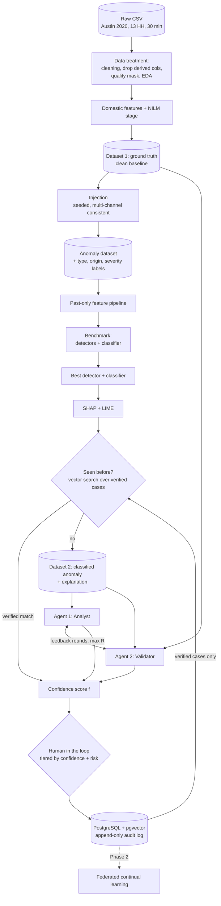

# EnergyMind Tunisia — A Trust Layer for Smart-Meter Data

> **TSYP14 Technical Challenge · Phase 1 submission (deadline 15 Oct 2026)**
> Physics-consistent anomaly injection, two-agent deliberation and learned confidence for human–AI escalation, designed to extend to federated continual learning in Phase 2.

Automated grid decisions consume smart-meter data that can be faulty, biased or falsified. Detecting an anomaly is not enough: the system must also say **how sure it is, why, and who should decide**. EnergyMind is a trust layer that sits between raw meter data and any automated action on it.


---

## What this project does

| Challenge goal | What EnergyMind provides |
| --- | --- |
| **G1** Detect faults, degraded sensors, bias, falsified readings; separate genuine grid events from data-quality problems | Seeded, physics-consistent anomaly injector with origin labels, and a benchmark of statistical, classical and deep detectors |
| **G2** Confidence score, plain-language explanation, auditable log | Learned confidence `f`, SHAP + LIME explanations, append-only PostgreSQL audit log |
| **G3** Thresholds for automatic action vs human approval; operator interface | Three-tier routing by confidence and action risk, a never-automate list, a review-card mock-up, simulated operators for over- and under-trust |
| **G4** Shared learning with privacy | Designed for Phase 2 (federated continual learning); not implemented in Phase 1 |

## Architecture



## Dataset

The input is `Austin_TX_US_2020.csv`: **13 smart-metered households, 30-minute data, 1 Jan – 30 Dec 2020**, 227,752 rows × 104 columns.

**The data is synthetic.** It uses Tunisian-grid-compatible electrical parameters (230 V, 50 Hz) on an Austin calendar and climate. We state this explicitly in the paper and docs.

The data audit (`docs/data_report.md`) found issues that shape the whole pipeline:

- **Exact electrical identities.** S = √(P² + Q²), PF = P/S, S = V·I/1000 and E = P·0.5 h hold almost exactly. A physics check therefore catches any single-channel edit, so injection must propagate consistently across channels.
- **Leaky pre-computed features.** 64 of the 104 columns are derived (rolling, lag, z-score, flags) and include the current value. We **drop all of them** and recompute past-only features after injection.
- **Trivial provided labels.** The 698 provided `spike`/`dropout` labels are single-interval events that break the identities. They are used only as a sanity test set, not as the benchmark.
- **Weak weather–load coupling, inconsistent metadata, incomplete energy balance.** Weather, household size/type and sub-meter totals are not used as strong evidence.

The full list of findings (F1–F10) with plots is in `docs/data_report.md`.

> The raw CSV (193 MB) is not committed. See [License and data](#license-and-data) for how to obtain it. A zstd Parquet of the measured and metadata columns (~10 MB) is used for the pipeline.

## Anomaly simulation

Anomalies are injected with a seeded, config-driven injector (`configs/injection.yaml`). Every type has two variants:

- **Naive:** edits one channel (models corruption in transmission or storage). A physics check catches it.
- **Consistent:** edits the root quantity and recomputes dependent channels (models an upstream sensor fault).

| Origin | Types |
| --- | --- |
| `data_quality` | additive bias, gain error (CT), voltage sensor drift, stuck-at, dropout / comms gap, dead sensor, noise burst, unit error, sub-meter bias |
| `adversarial` | under-reporting (theft), replay, mimicry |
| `physical_event` | coherent demand peak, neighborhood outage, voltage sag |

A genuine grid event and a fault can look identical on a single meter. They differ in being **simultaneous across households** and **physically consistent**, which is the evidence the Validator agent uses.

**Protocol:** inject only where `quality_mask = 1`; one anomaly per (household, interval); separate seeds for train/val/test; prevalence levels of 1%, 5% and 10% of household-hours; replay and mimicry withheld from train/val to test the "unknown, escalate" behaviour. Details and formulas: `docs/anomaly_generation.md`.

## Benchmark

Two tasks are scored separately: **detection** (is this window anomalous?) and **classification** (which type and which origin?).

| Family | Models |
| --- | --- |
| Baselines | Robust z vs hour-of-week median, physics + coherence rules |
| Forecasting | Seasonal-naive / SARIMA per household |
| Classical ML | Isolation Forest, Random Forest, ECOD / COPOD / HBOS (PyOD) |
| Distance-based | Matrix-profile discords and motifs (STUMPY), including a replay check |
| Deep | LSTM autoencoder, USAD, TranAD |
| Foundation model | MOMENT zero-shot (optional) |
| Ensemble | Stacked logistic regression or soft vote over calibrated members |

**Evaluation rules:** an event is one injected interval; a detection counts if any alert falls inside it (±1 interval). **No point-adjusted F1.** We report event precision/recall/F1 at a fixed false-alarm budget, PR-AUC, VUS-PR, false alarms per household-week, detection latency, per type × severity × variant recall, macro-F1 for type, an origin confusion matrix, ECE, and inference time per household-day. Results use 3 injection seeds (mean ± std) on a temporal test split and a household hold-out.

Results are written to `results/runs.jsonl`; tables are generated from it by `notebooks/04_benchmark.ipynb`.

## Explanations and the anomaly record

For the selected model, SHAP (TreeSHAP for tree models) and LIME produce per-case attributions, which are compared for stability and agreement. Each flagged case becomes an **anomaly record** with type, origin, severity, scores, attributions, a 64-dimensional signature and a plain-language template explanation.

## Memory and audit log

A single **PostgreSQL + pgvector** database serves as both the "Seen before?" vector store and an **append-only, hash-chained audit log** (no `UPDATE`/`DELETE`). Only **verified** cases are retrieved for reuse, so unconfirmed feedback cannot leak into later decisions. Schema: `sql/schema.sql`.

## Two-agent decision loop

| | Agent 1 — Analyst | Agent 2 — Validator |
| --- | --- | --- |
| Reads | Detector score, type/origin probabilities, SHAP/LIME | Household baseline, physics residuals, neighborhood coherence, NILM residuals, retrieved historical cases |
| Does **not** read | History, neighbors | Model probabilities and SHAP (avoids anchoring) |
| Question | What does the model say, and what should be done? | Is that consistent with physics, the neighborhood and history? |

The agents choose from a **closed action set**, return structured JSON, exchange feedback for at most `R_max` rounds, and must cite evidence (uncited evidence is rejected). Giving them different evidence is what makes their agreement informative. Rule-based versions are kept as the fallback and as the ablation baseline.

## Confidence score and routing

For each case, the confidence is a calibrated probability that the final decision is correct:

```
f = σ( β0 + βA·logit(A) + βL·L + βH·logit(H) + βG·G + βQ·Q )
```

| Term | Meaning |
| --- | --- |
| **A** | Local accuracy: calibrated precision of the model for the predicted type at this score |
| **L** | Convergence of the two agents (1 if converged in round 1, down to 0 if not converged) |
| **H** | Similarity-weighted outcome of top-k *verified* historical cases, shrunk toward a prior |
| **G** | Share of Validator checks supporting the proposed origin, weighted by validation precision |
| **Q** | Data completeness of the window |

The weights β are **learned on validation data**, not hand-set, and calibration is checked on the test set (reliability diagram, ECE).

| Tier | Condition (thresholds chosen on validation) |
| --- | --- |
| 1 — Autonomous | `f ≥ τ_auto`, low-risk and reversible action, agents converged, origin = `data_quality` |
| 2 — Human approval | `f ≥ τ_review`, or any medium-risk action |
| 3 — Human-led | low `f`, no convergence, unseen type, any high-risk action, or origin = `adversarial` |

The main evidence for `f` is the **risk–coverage curve** against the raw model probability. Cases the tiers escalate reach the **human user** as a short review card (approve / reject / request more information); the final decision is stored only after the human answers.

## Quickstart

> Requires Python 3.11+, Docker (for PostgreSQL + pgvector), and `make`. Adjust commands to match the repository's `Makefile`.

```bash
# 1. Clone and install
git clone https://github.com/emnagrajaa/EnergyMind.git
cd EnergyMind
python -m venv .venv && source .venv/bin/activate
pip install -e .

# 2. Provide the data (see "License and data")
#    place Austin_TX_US_2020.csv in data/raw/

# 3. Start the memory / audit database
cp .env.example .env
docker compose up -d

# 4. Run the pipeline
make data      # load, clean, quality mask, features
make inject    # generate the anomaly dataset and labels
make bench     # run the benchmark, write results/runs.jsonl
make demo      # ~20 cases through agents, confidence, routing, audit log
make test      # unit tests (no real data or Postgres needed)
```

## Repository structure

```
EnergyMind/
├── configs/            # data, injection, models, policy, agents (YAML)
├── data/               # raw (gitignored), clean, features, injected labels, splits
├── sql/schema.sql      # anomaly_case (pgvector, HNSW) + audit_event (hash chain)
├── src/energymind/
│   ├── io.py clean.py validate.py splits.py
│   ├── inject/         # data_quality.py, adversarial.py, physical.py
│   ├── features.py nilm.py
│   ├── detect/         # robust_z, rules, sarima, iforest, lstm_ae, pyod, matrix_profile, ...
│   ├── classify.py evaluate.py explain.py records.py
│   ├── store.py retrieval.py
│   ├── agents/         # analyst, validator, llm_agent, deliberation, prompts/
│   └── confidence.py policy.py review.py pipeline.py
├── notebooks/          # 01 inspect · 02 EDA · 03 injection gallery · 04 benchmark · 05 decision demo
├── tests/              # leakage, physics identities, injection determinism, deliberation, confidence
├── results/            # runs.jsonl, figures/
└── docs/               # data_report, anomaly_generation, model_card, decision_protocol, fcl_design, proposal/
```

## Phase 2: federated continual learning

Phase 2 reframes shared learning as **federated continual learning (FCL)** using Avalanche with FedAvg. Nodes first share validated decisions (anomaly cards, never raw data); FCL then handles anomaly types that no node has seen, with replay to limit forgetting. Phase 1 contains the design only (`docs/fcl_design.md`). Other cities in the original data package, if available, are the natural additional nodes.

## Limitations

- The dataset is synthetic with weak weather–load coupling and only 13 households; conclusions about real fault rates or real reviewer behaviour are **not** claimed.
- The human-in-the-loop card is rendered in the pipeline output; connecting it to a real reviewer UI and measuring trust with users is Phase 2.
- The Austin calendar and climate differ from a Tunisian deployment.
- Benchmark results are preliminary until the test set and seeds are frozen.

## License and data

- **Code:** _add license (MIT or Apache-2.0)_ — see `LICENSE`.
- **Data:** `Austin_TX_US_2020.csv` exceeds GitHub's per-file limit; its source and licence are documented in `DATA_LICENSE.md`. _Add the download source / Kaggle link here._ The repository commits only a SHA-256 manifest (`data/raw/MANIFEST.csv`) and, where the licence allows, a compact Parquet of measured columns.

## Team

_Add team members, affiliation (IEEE Student Branch) and contact._

## Acknowledgements

TSYP14 EnergyMind Tunisia challenge organisers. Benchmarking practice follows the TSB-AD evaluation recommendations (no point-adjust, VUS-PR).

# EnergyMinds-Submission
