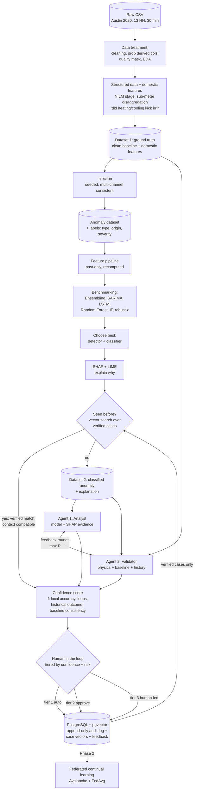
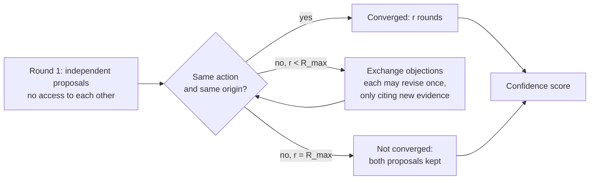
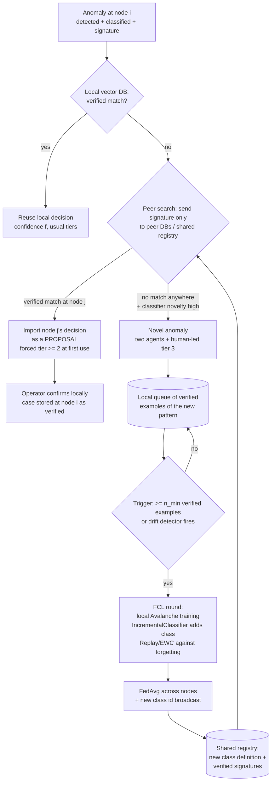
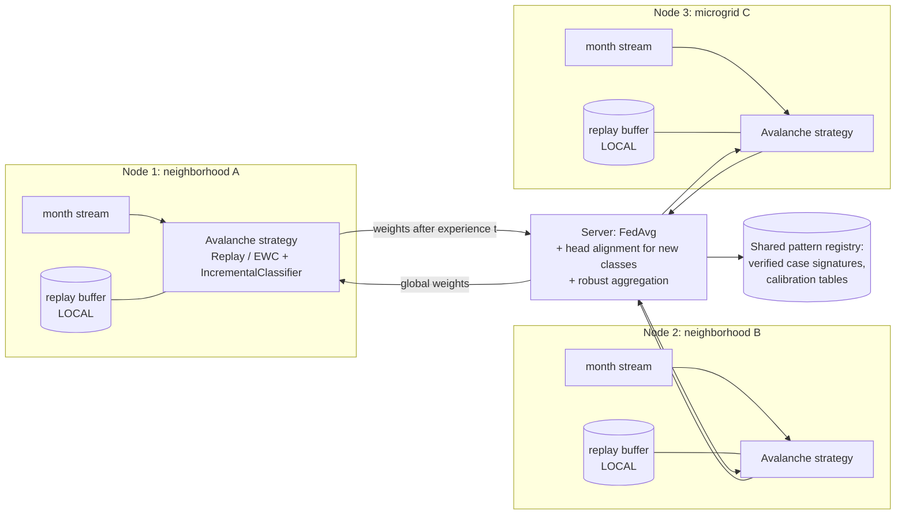

# EnergyMind Tunisia — Phase 1 Research Plan & Proposal Blueprint

Oct 9, 2026 · @Amine

## 1. Executive summary (v2)

**v2 keeps your architecture as designed (NILM stage → injection → benchmark → SHAP + LIME → "Seen before?" vector DB → two agents with feedback → confidence score → human in the loop → memory) and makes each block precise enough to code and defend.** Phase 2 is reframed as **federated continual learning (FCL)** with Avalanche; Phase 1 does not implement it.

**What changed from v1, and why**

- **Dataset is now real input, not a guess.** `Austin_TX_US_2020.csv` was profiled: 13 households, 30-minute data for 2020, 104 columns. It is a **synthetic dataset** with European/Tunisian electrical parameters (230 V, 50 Hz) on an Austin calendar (Section 2). That is allowed by the challenge ("simulated equivalents"), but it must be stated.
- **Two blocking data issues found:** (1) 64 of the 104 columns are pre-computed features (calendar, rolling, lag, ratio, z-score, flags); the rolling and z-score ones include the current value, so derived columns must be **dropped and recomputed after injection**, otherwise injected anomalies leak into or hide from features; (2) the 698 provided anomaly labels are single-sample spikes/dropouts that **break exact electrical identities**, so any physics check finds them at \~100%. They are a sanity test, not your benchmark.
- **Two agents, vector DB and confidence formula are kept.** Each is formalized: agents get *different evidence* so their agreement means something; `nb_loops` becomes a convergence term; the `weighted_mean` terms become similarity-weighted outcomes of *verified* cases; the weights of f are **learned on validation data**, not hand-set.
- **Audit log:** a vector DB alone is the wrong tool for an audit log, but you do not need SQLite either. **PostgreSQL + pgvector** gives one production database that is both your vector store and an append-only, tamper-evident log (Section 10).
- **New: step-by-step coding plan** (Section 15) with module names, function contracts and key code.

**Verdict for Phase 1 (deadline 15 Oct 2026):** implement data prep, injection, the benchmark, SHAP and the anomaly record; implement the agents, confidence score and vector DB as a **working minimal prototype on a small set of cases**; document FCL as Phase 2 design.

## 2. What the Austin 2020 dataset actually is

**The file is a clean, synthetic, single-city panel: 13 smart-metered households, every 30 minutes, 1 Jan – 30 Dec 2020, with whole-home electrical measurements, four sub-meters, PV/battery/EV channels, weather, and 64 pre-computed features.** All figures below were measured on the uploaded file.

### Shape

| Property | Value |
| --- | --- |
| Rows × columns | 227,752 × 104 (193 MB CSV; 47.7 MB as Parquet, 10.3 MB for the 37 measured/meta columns) |
| Households | 13 (`HH_00053_AUS` … `HH_00189_AUS`); types: apartment small/large, house small/large, **commercial\_small** |
| Interval | 30 min; 17,520 expected rows per household |
| Span | 2020-01-01 00:00 → 2020-12-30 23:30 (31 Dec absent) |
| Missing records | 8 in total (3 households have 1–3 missing slots, e.g. HH\_00053 on 8 Apr, 16 May, 24 May); 0 duplicate keys |
| Missing values | none, except leading NaNs in lag/rate features |
| Timestamp | naive local; `timezone_offset_h` = −6 on every row, **no DST** (2020-03-08 02:00 exists) |
| Provided labels | `anomaly_flag` = 698 rows (0.31%): `spike` 490, `dropout` 208 |

### Column groups

| Group | Columns | Use |
| --- | --- | --- |
| Identity / metadata | household\_id, household\_type, tariff\_category, occupants, size\_m2, has\_solar/battery/ev, capacities | Static context; see metadata issue below |
| Electrical (measured) | voltage\_v, current\_a, active\_power\_kw, reactive\_power\_kvar, apparent\_power\_kva, power\_factor, frequency\_hz, total\_energy\_kwh | **Primary channels for injection and detection** |
| Sub-meters | sub1\_heating, sub2\_cooling, sub3\_lighting, sub4\_appliance (kWh / 30 min), ev\_load\_kw | NILM targets / domestic features |
| DER | solar\_generation\_kw, battery\_charge\_kw, battery\_discharge\_kw, renewable\_contribution\_pct | Context, physical events |
| Weather / context | temperature\_c, humidity\_pct, weather\_code/condition, cloud\_cover\_pct, occupancy\_probability, holiday flags, tariff\_rate | Context features |
| Derived (64 cols) | calendar, sin/cos, rolling 2h/4h/24h/7d stats, lags, rate of change, ratios, load\_factor, power\_zscore, is\_demand\_spike, is\_statistical\_anomaly, cumulative kWh, cost | **Drop; recompute in our own pipeline** |

### Findings that change the plan

| # | Finding (measured) | Consequence |
| --- | --- | --- |
| F1 | Electrical identities hold almost exactly: S = √(P² + Q²), PF = P/S, S = V·I/1000, E = P·0.5 h, cost = E·tariff (median relative error ≈ 1e-5) | Data is generated by formula. A physics check is an **exact** detector: injecting into P alone is trivially caught. Injection must **propagate consistently** across channels (Section 7) |
| F2 | Provided `spike`/`dropout` labels are single intervals (696 of 697 runs have length 1); dropouts set P = 0 while V, I, S, energy and sub-meters stay normal; spikes break V·I·PF by a median 82% | Provided labels are trivially detectable and unrealistic. Use them as a **sanity test set**, mask them out of the clean baseline, and build the real benchmark by injection |
| F3 | Rolling features include the current value (`power_2h_mean` = trailing mean incl. t); `power_zscore` = (P − 7-day mean)/7-day std incl. t; `is_demand_spike`, `is_statistical_anomaly` are rule outputs | Using them is leakage (label-like flags) and they would not change when we inject. **Drop all 64 and recompute past-only after injection** |
| F4 | 230 V nominal (217–241 V), 50 Hz ± 0.2, costs in EUR | Not US electrical parameters (Austin is 120/240 V, 60 Hz). Honest framing: *Tunisian-grid-compatible electrical parameters (STEG is 230 V/50 Hz) on an Austin calendar and climate* |
| F5 | Temperature differs between households at the same timestamp (median std 1.46 °C); 7,201 rows are "snow" with temperature > 10 °C | Weather is generated per row, not shared. Weather features are weak evidence; do not build "genuine heat-wave" logic on them without injecting coherent events |
| F6 | Cooling sub-meter has ≈ 0 correlation with temperature; household load is higher in winter and at night (00–07 h ≈ 3.9 kW vs daytime ≈ 2.6 kW) | The generator does not model AC physics. Genuine-event examples must be **injected** (coherent peaks, outages) and the limitation stated |
| F7 | Sub-meters sum to a median 43% of total energy (5th–95th pct: 14%–108%) | Not a closed energy balance; there is an unmetered remainder. A "sub-meters > total" check is useful but noisy |
| F8 | Metadata contradicts itself (a `house_large` of 73 m², `apartment_small` of 245 m²) | Do not use size/type as features or explanations |
| F9 | Natural flat runs of identical active power reach 16 intervals (8 h) | Stuck-at injections shorter than 8 h are indistinguishable by flatness alone; use multi-channel evidence |
| F10 | Households correlate at daily level (mean pairwise r = 0.70) but weakly at 30 min (r = 0.19) | Cross-household coherence is usable for genuine-event vs fault discrimination at hourly/daily scale |

**Questions this raises for the team (also in Section 20):** where does the file come from (generator, licence, other cities in the original `Data.zip`)? If other cities exist in the zip, they are the natural Phase 2 nodes.

**Repo:** 193 MB exceeds GitHub's 100 MB per-file limit. Commit the 37 measured/meta columns as zstd Parquet (10.3 MB) if the licence allows, or publish on Kaggle and link it.

## 3. Challenge requirements mapped to your architecture

Phase 1 = 50 points (requirements 10, technical approach 20, deliverables 10, innovation 10). The proposal must give scope, objectives, a data/anomaly-simulation plan and a preliminary design for each goal; the repo must contain the dataset and Phase 1 code.

| Requirement | Block in your diagram | Phase 1: built | Phase 1: designed only |
| --- | --- | --- | --- |
| G1 detect faults, degraded sensors, bias, corrupted/falsified readings | Injection (syringe) → Benchmark → "Classify the anomaly" | Injector, labelled dataset, benchmark of ≥ 4 models | — |
| G1 genuine grid event vs data-quality problem | Labels with `origin`; ground-truth box feeding agents | Injected coherent peaks/outages + origin labels; physics and coherence checks | Learned origin classifier tuning |
| G2 confidence score | Confidence score f(…) | f implemented, weights fitted on validation, reliability diagram | — |
| G2 plain-language explanation | SHAP + LIME "Explain why" | SHAP on the selected model + LIME comparison; template text | Explanation-quality user test |
| G2 auditable decision log | Vector DB box (classified anomaly + explanation + decision + confidence + feedback) | Postgres + pgvector schema; append-only log | Hash-chain verification job |
| G3 thresholds for automatic action / human approval | Confidence → Human in the loop | Tier thresholds chosen on validation; never-automate list | — |
| G3 operator interface | Human in the loop | Mock-up of the review card | Streamlit app |
| G3 over- and under-trust | Feedback arrows, sad face | Simulated-operator experiment | User study |
| G4 shared learning, privacy | (Phase 2) | — | FCL with Avalanche + FedAvg; sharing protocol |
| Evaluation: precision/recall, FPR, explanation quality, latency | Benchmarking + results visualisation | Metrics on injected test set | — |
| Document anomaly generation | Injection | `docs/anomaly_generation.md` + YAML + seeds | — |

Business scope (+1 bonus) costs one subsection: deployment cost of a Postgres instance, compute for retraining, operator time per alert.

## 4. Your architecture, formalized

Same blocks and order as your diagram; each arrow now carries a defined artifact. Dashed = Phase 2.



| Block | Input | Output | Phase 1 |
| --- | --- | --- | --- |
| Data treatment | raw CSV | `clean.parquet`, quality mask, EDA, data report | Build |
| Domestic features / NILM | clean | sub-meter features + optional disaggregation model | Build (light) |
| Ground truth (Dataset 1) | clean + features | versioned Parquet, provenance column | Build |
| Injection | Dataset 1 + YAML + seed | anomaly dataset + `labels.parquet` | Build |
| Benchmark | features + labels | `runs.jsonl`, results table, plots | Build |
| SHAP + LIME | best model + case | attribution JSON | Build |
| Seen before? | case vector | top-k verified cases + similarity | Build (pgvector) |
| Two agents | case record, baseline, history | two proposals, rounds, final decision | Build minimal |
| Confidence f | agent outputs + model + history | score ∈ \[0, 1\] + components | Build |
| Human in the loop | score, risk, record | tier + operator action | Simulate; mock-up UI |
| Audit log / memory | every step | rows in Postgres | Build |
| FCL | node models | global model | Design |

## 5. Data preparation for this dataset

**Goal: a clean, gap-free, past-only-feature baseline in which every value is tagged measured, imputed, derived, inferred or simulated.** Never edit the CSV; every layer is regenerated by code.

| Step | Operation | Why (finding) | Output | Check |
| --- | --- | --- | --- | --- |
| 1 | Checksum the CSV, convert to Parquet | Reproducibility | `data/raw/MANIFEST.csv`, `raw.parquet` | SHA-256 re-verifies |
| 2 | Split columns into measured / metadata / derived; **drop the 64 derived** | F3 leakage | `measured.parquet` (37 cols) | No rolling/lag/zscore/flag column survives |
| 3 | Parse time; attach fixed UTC−6; convert to UTC | No DST in data | `ts_utc` | Strictly increasing per household |
| 4 | Reindex every household to the full 30-min grid; mark the 8 missing records | Missing records ≠ missing values | `is_missing_record` | 17,520 rows per household |
| 5 | Keep provided labels in a **separate** table, then mask those rows in the baseline (set to NaN + `provided_anomaly=1`) | F2: baseline must be clean | `provided_labels.parquet` | 698 rows moved |
| 6 | Physics residuals: r\_S = S − √(P²+Q²), r\_VI = S − V·I/1000, r\_E = E − 0.5·P, r\_PF = PF − P/S | F1: exact identities | residual columns | All |
| 7 | Plausibility bounds (V 207–253 V, f 49.5–50.5 Hz, PF 0–1, P ≥ 0, sub-meters ≤ total + tolerance) | Impossible values | `flag_*` columns | Count per household |
| 8 | Flat-run length per channel | F9 | `flat_run_len` | Distribution reported |
| 9 | Impute only masked/missing single slots (linear on P, recompute dependent channels with identities); longer gaps stay NaN | Keep physics consistent | `is_imputed` | Identities still hold after imputation |
| 10 | Quality mask = no flag, no imputation, not provided-anomaly | Safe injection zones | `quality_mask` | % clean per household |
| 11 | Splits (below) | Leakage-free evaluation | `splits.json` | No overlap |

**Splits (fixed, written once):** temporal: train Jan–Aug, validation Sep–Oct, test Nov–Dec; plus a household hold-out: 10 households train/val, 3 households test (choose one with solar, one with EV, one commercial\_small). Also tag each row with its **month as an "experience id"** now; Phase 2 continual learning reuses it at no cost.

**EDA notebook (plots → findings in the report):** missing-record map (household × day); weekly profile heatmap (hour × weekday) per household type; monthly load and temperature on twin axes (shows F6); P vs V·I·PF scatter coloured by provided label (shows F1/F2); sub-meter share boxplots (F7); cross-household correlation matrix at 30 min and daily (F10); distribution of active power per household on log scale; flat-run histogram (F9); temperature vs weather condition (F5).

**Done when:** `make data` rebuilds `clean.parquet` from the CSV with identical checksums; all findings F1–F10 are in `docs/data_report.md` with plots.

## 6. Domestic features and the NILM stage at 30 minutes

**Keep your NILM block, but scope it to what 30-minute data supports: energy disaggregation into the four measured sub-meter categories, validated against the sub-meters you already have.** "Did the fridge turn on?" needs 1 Hz–1 min data; at 30 min a fridge cycle is averaged away. "Did heating/cooling/EV kick in?" is answerable.

| Feature | Source | Provenance |
| --- | --- | --- |
| Heating, cooling, lighting, appliance kWh and their shares | sub1–sub4 | measured |
| Unmetered remainder = E − Σ sub − 0.5·EV | derived from measured | derived |
| Heating/cooling "on" state = sub-meter > household-specific threshold (e.g. 30% of its 95th percentile) | derived | derived |
| EV session start, duration, energy | ev\_load\_kw | derived |
| PV self-consumption, battery cycling | DER channels | derived |
| Base load (night min), peak/average, load factor, ramp rate | P | derived (recomputed past-only) |
| **NILM estimate** of the four categories from aggregate P, Q, time and weather | LightGBM/MLP multi-output regressor trained on train households | **inferred** |

**Why train an NILM model if sub-meters exist?** Because in deployment most meters have no sub-metering. The model learns aggregate → categories on households with sub-meters, and you report its error on held-out households. Its outputs carry `provenance = inferred` and are **never** used as labels. Its residual (measured sub-meter − NILM estimate) is itself a useful anomaly feature: a biased sub-meter disagrees with what the aggregate implies.

**Metrics:** per-category MAE (kWh), normalized energy error, and F1 on the derived on/off states, on the 3 held-out households. Mark results planned until run.

## 7. Anomaly injection with consistent multi-channel propagation

**Because the identities in F1 are exact, every injection has two variants: a *naive* one that edits one channel (a physics check catches it), and a *consistent* one that edits the root quantity and recomputes dependent channels. The benchmark uses both, and reports results separately.** Consistent faults model a corrupted sensor upstream of the meter's own computation; naive faults model corruption in transmission or storage.

Notation for household h, channel x, interval I = \[t0, t0 + L): σ\_h = 1.4826·MAD of the past-only residual vs the household's hour-of-week median μ\_h.

### Labels

`anomaly_id, household_id, channel, t_start, t_end, type, origin ∈ {data_quality, adversarial, physical_event}, severity ∈ {low, med, high}, variant ∈ {naive, consistent}, scope ∈ {single, neighborhood}, params (JSON), seed, injector_version, provenance = simulated`.

### Phase 1 set

| Type | Origin | Root edit on t ∈ I | Propagation (consistent variant) | Ranges |
| --- | --- | --- | --- | --- |
| Additive bias | data\_quality | P̃ = P + kσ\_h | Q̃ = Q·P̃/P; S̃, Ĩ = S̃/V, Ẽ = 0.5·P̃ | k ∈ ±{0.5, 1, 2}; L 6 h – 7 d |
| Gain error (miscalibrated CT) | data\_quality | Ĩ = (1 + g)·I | S̃ = V·Ĩ, P̃ = PF·S̃, Q̃, Ẽ | g ∈ ±{0.05, 0.1, 0.25} |
| Voltage sensor drift | data\_quality | Ṽ = V + d·(t − t0)/L | Ĩ = S/Ṽ (power unchanged) or S̃ = Ṽ·I (power wrong) | d ∈ ±{2, 5, 10} V over 3–30 d |
| Stuck-at | data\_quality | all channels = values at t0 | already consistent | L 12 h – 3 d (beyond natural 8 h runs) |
| Dropout / comms gap | data\_quality | all channels NaN | — | L 30 min – 1 d |
| Dead sensor | data\_quality | P = 0 only | naive only (that is the fault) | L 1 h – 1 d |
| Noise burst | data\_quality | P̃ = P + ε, ε \~ N(0, (ασ\_h)²) | propagate | α ∈ {0.5, 1, 2} |
| Unit error | data\_quality | P̃ = P·1000 (W written as kW) | naive | L 1 h – 1 d |
| Sub-meter bias | data\_quality | sub2 × (1 + g) | none (breaks Σsub vs E and NILM residual) | g ∈ {0.3, 0.6} |
| Under-reporting (theft) | adversarial | P̃ = r·P | consistent | r ∈ \[0.3, 0.8\], L 3–30 d |
| Replay | adversarial | all channels copied from t − 7 d | consistent by construction | L 1–3 d |
| Mimicry | adversarial | all channels = household's typical day μ\_h + small noise | consistent | L 1–7 d |
| Coherent demand peak | physical\_event | P̃ = P·(1 + p·shape(t)) on ≥ 40% of households simultaneously | consistent | p ∈ {0.3, 0.6, 1.0}, 2–6 h |
| Neighborhood outage | physical\_event | all channels 0, V = 0, on all households | consistent | 30 min – 4 h |
| Voltage sag event | physical\_event | V × 0.9 on all households | P unchanged, I up | 1–2 h |

**Physical events vs faults is the key test:** a coherent peak or outage looks exactly like a fault on one meter, and differs only in being **simultaneous across households** and **physically consistent**. That is the evidence Agent 2 uses.

### Protocol

- Inject only where `quality_mask = 1`; one anomaly per (household, interval); seeds differ for train/val/test.
- Prevalence levels: 1%, 5%, 10% of household-hours.
- **Unseen-type test:** withhold replay and mimicry from train/val; test whether the system says "unknown" and escalates.
- After injection, **recompute all features from the injected channels**; never reuse baseline features.
- Report every metric by type × severity × variant.

**Phase 2 extension:** compound and overlapping faults; drift that follows temperature; coordinated multi-meter falsification that preserves neighborhood totals; per-month injection streams for continual learning.

## 8. Benchmark: your four candidates plus baselines

**Two tasks, scored separately: detection (is this window anomalous?) and classification (which type and which origin?).** Your candidates map onto them as follows; robust z and physics rules are mandatory baselines because judges will ask what simple methods achieve on synthetic data.

| Model | Task | Input | How it scores | Notes |
| --- | --- | --- | --- | --- |
| Robust z vs hour-of-week median | detection | P per household | abs residual / σ\_h | The bar to beat |
| Physics + coherence rules | detection + origin | residuals, cross-household share | rule hits | Exact on naive variants by design; report both variants |
| SARIMA (or seasonal-naive) per household | detection | P series | forecast residual | Fit per household on train months; SARIMA(1,0,1)(1,0,1)₄₈ is slow at 30 min, keep seasonal-naive as fallback |
| LSTM autoencoder | detection | 48-step windows of multi-channel data | reconstruction error, threshold μ + kσ on validation | Same family as the Nowroozi et al. FL paper, and PyTorch, so it is reusable in Phase 2 Avalanche |
| Isolation Forest | detection | window features | path length | Named in the challenge hints |
| Random Forest | classification | window features + physics residuals + coherence | class probabilities | TreeSHAP-friendly |
| Ensembling | both | outputs of the above | stacked logistic regression or soft vote | Only after the members are calibrated |

**Unit of evaluation:** an event = one injected interval. A detection counts if any alert falls inside the event (plus a tolerance of 1 interval). **No point-adjusted F1.** Also report window-level PR-AUC and VUS-PR (the measure the TSB-AD benchmark found most reliable).

**Metrics:** event precision/recall/F1 at a fixed false-alarm budget, PR-AUC, false alarms per household-week, detection latency (intervals from t\_start), per type/severity/variant recall, macro-F1 for type, **origin confusion matrix** (physical event called a fault and vice versa), ECE for calibrated probabilities, inference time per household-day (the challenge's "response latency").

**Selection rule:** choose the detector with the best event-F1 at the false-alarm budget among those with per-type recall ≥ a floor on high-severity anomalies; choose the classifier by macro-F1 and origin accuracy. Report on the temporal test and the household hold-out; 3 injection seeds, mean ± std.

| Model | Variant | Prev. | Event P | Event R | F1 | PR-AUC | FA / HH-week | Latency | Origin acc. | ECE |
| --- | --- | --- | --- | --- | --- | --- | --- | --- | --- | --- |
| Robust z | consistent | 5% | planned | planned | planned | planned | planned | planned | — | planned |
| Rules | consistent | 5% | planned | planned | planned | planned | planned | planned | planned | — |
| SARIMA / seasonal-naive | consistent | 5% | planned | planned | planned | planned | planned | planned | — | planned |
| LSTM-AE | consistent | 5% | planned | planned | planned | planned | planned | planned | — | planned |
| Isolation Forest | consistent | 5% | planned | planned | planned | planned | planned | planned | — | planned |
| RF (classifier) | consistent | 5% | — | — | macro planned | — | — | — | planned | planned |
| Ensemble | consistent | 5% | planned | planned | planned | planned | planned | planned | planned | planned |
| Any model | provided labels (sanity) | 0.31% | planned | planned | planned | — | — | — | — | — |

### More accurate detectors to add

**Add three cheap, strong families before any heavy deep model: PyOD's ECOD/COPOD, matrix-profile discords (and motif search for replay attacks), and USAD/TranAD for multivariate windows; add one time-series foundation model (MOMENT) as a zero-shot comparison.** The NeurIPS 2024 TSB-AD benchmark ([Liu & Paparrizos](https://nips.cc/virtual/2024/poster/97690)) evaluated 40 detectors on 1,070 series and found that simpler and statistical methods often beat complex neural ones overall, neural models look stronger on multivariate data, and foundation models do well on point anomalies. That supports a mixed ensemble, chosen by your own results.

| Model | Type | Why it fits this data | Library | Cost |
| --- | --- | --- | --- | --- |
| ECOD, COPOD, HBOS | Statistical, parameter-free | Fast, strong tabular baselines on window features; per-feature tail scores are directly explainable | [PyOD 2](https://arxiv.org/abs/2412.12154) | Seconds, CPU |
| Matrix profile (discords) | Distance-based, univariate | Finds the most unusual subsequence per household; good on spikes, stuck-at, dropouts | STUMPY (also wrapped in PyOD) | Seconds–minutes, CPU |
| Matrix profile (motifs, AB-join) | Distance-based | **Replay attack detector**: a copied day appears as a near-zero-distance match to an earlier day, which no other model looks for | STUMPY | Minutes, CPU |
| USAD | Deep, multivariate AE with adversarial training | Multichannel windows (P, Q, V, I, sub-meters); fast to train | TSB-AD or reference code | Minutes, CPU |
| TranAD | Deep, transformer reconstruction | Strong on multivariate benchmarks; check that its reported scores did not rely on point-adjust before quoting them | TSB-AD or reference code | Minutes, CPU/GPU |
| MOMENT (small 40M / base 125M / large 385M) | Time-series foundation model, reconstruction-based anomaly score | Zero-shot detector with no training; a clean "foundation model" row in your table | [MOMENT](https://huggingface.co/papers/2402.03885.md), checkpoint `AutonLab/MOMENT-1-large` | Minutes, CPU for small/base |
| LightGBM / XGBoost | Gradient boosting classifier | Usually the best **type and origin classifier** on engineered features; TreeSHAP exact | lightgbm, xgboost | Seconds |

**How to use them.** The [TSB-AD package](https://pypi.org/project/TSB-AD/) bundles many of these detectors with a common interface and its evaluation measures, which saves you writing wrappers. Expected best combination (to be confirmed by the benchmark, not assumed): physics rules + ECOD + matrix profile + LSTM-AE or USAD for detection, LightGBM for type/origin, matrix-profile motifs as a dedicated replay check.

Add these rows to the results table: ECOD, COPOD, MP-discord, MP-motif (replay only), USAD, TranAD, MOMENT zero-shot, LightGBM (classifier).

## 9. SHAP + LIME explanations and the anomaly record

**Keep both, with distinct jobs: SHAP is the explanation you store and show; LIME is the cross-check whose agreement with SHAP becomes an explanation-reliability signal.**

| Method | Applied to | Output stored | Caveat |
| --- | --- | --- | --- |
| TreeSHAP | Random Forest classifier, Isolation Forest | top-k features with signed contributions per case | Explains the model, not the physical cause |
| KernelSHAP / DeepSHAP | LSTM-AE reconstruction error (per channel and time step) | which channel and which half-hour drove the error | Slow; run on flagged cases only |
| LIME (tabular) | same classifier | top-k features | Unstable; run 5 times with different seeds |
| Evidence (rules) | physics residuals, coherence share, baseline deviation | observed vs expected values with units | Primary text for the operator |

**Explanation reliability** E\_rel = Jaccard overlap of SHAP and LIME top-5 features, averaged over LIME seeds. Low overlap is shown as "explanation unstable" and lowers Agent 1's weight (Section 11). It also answers the challenge's "explanation quality" metric quantitatively, together with a sanity test: for an injected sub-meter bias, the sub-meter features must rank in the top 3.

**Prediction ≠ cause.** The record separates `model_explanation` (SHAP/LIME) from `cause_hypotheses`, written as hypotheses with supporting and contradicting evidence.

### Anomaly record (Dataset 2 row)

```json
{
  "anomaly_id": "uuid", "household_id": "HH_00072_AUS",
  "t_start": "2020-11-14T18:00:00Z", "t_end": "2020-11-15T06:00:00Z",
  "detection": {"model": "lstm_ae", "version": "0.1.0", "score": 0.83, "p_anomaly": 0.91},
  "classification": {"model": "rf", "version": "0.1.0",
    "type_probs": {"gain_error": 0.64, "additive_bias": 0.22, "coherent_peak": 0.06},
    "origin_probs": {"data_quality": 0.81, "physical_event": 0.07, "adversarial": 0.12}},
  "evidence": [
    {"check": "baseline_deviation", "observed_kw": 5.1, "expected_kw": 3.9, "z": 3.4},
    {"check": "neighborhood_share_elevated", "value": 0.08},
    {"check": "current_vs_power_identity", "rel_residual": 0.0},
    {"check": "nilm_residual_cooling_kwh", "value": 0.31}
  ],
  "explanation": {"shap_top": [["current_ratio_to_baseline", 0.38], ["nilm_residual_total", 0.21]],
                  "lime_top": ["current_ratio_to_baseline", "pf_deviation"], "reliability": 0.6},
  "cause_hypotheses": ["CT gain error (supported: current and power up together, neighbours normal)"],
  "severity": "medium", "limitations": ["weather is synthetic and weakly informative"],
  "text": "Household 72 used about 1.2 kW more than its usual evening level for 12 h; only 8% of neighbours rose, so a meter calibration fault is more likely than real demand.",
  "versions": {"features": "…", "git": "…", "data_sha": "…"}
}
```

The `text` is filled from a template over `evidence`, not free-written, so numbers cannot be invented.

## 10. Seen before? Vector DB, memory, and the audit-log question

**Answer to "can't we just use a vector DB for the audit log instead of SQLite?": use PostgreSQL with the pgvector extension. It is one database that is both your vector DB and a proper audit log, and it is the more production-ready and scalable choice of the options on the table.**

### Why not a pure vector DB for the log

| Audit-log requirement | Dedicated vector DB (Qdrant, Milvus, Chroma, Weaviate) | PostgreSQL + pgvector |
| --- | --- | --- |
| Immutable, append-only history | Points can be upserted or deleted; no permission model to forbid it per collection | `REVOKE UPDATE, DELETE` on the log table; insert-only role |
| Tamper evidence | Not built in | Hash chain column (each row stores SHA-256 of previous row + its own content), verifiable by a query |
| Transactions across record + decision + feedback | Single-point operations; no multi-table ACID | Full ACID |
| Exact queries (by household, time range, operator, version), joins, ordering | Payload filters only; no joins | Native SQL, indexes |
| Similarity search | Yes, built for it | Yes: HNSW index, cosine/L2, filtered search |
| Scale | Billions of vectors | Millions of vectors per node comfortably; partition by month; read replicas. Your scale: hundreds to thousands of cases per neighborhood per year |
| Ops for a student team | Extra service | One Docker container; managed versions exist on every cloud |

If the vector side later grows beyond Postgres (it will not at neighborhood scale), add Qdrant **for vectors only** and keep the log in Postgres, keyed by `anomaly_id`. SQLite is fine for unit tests, not for the deployed system.

### Schema (Phase 1)

```sql
CREATE EXTENSION IF NOT EXISTS vector;

CREATE TABLE anomaly_case (
  anomaly_id     uuid PRIMARY KEY,
  household_id   text NOT NULL,
  t_start        timestamptz NOT NULL,
  t_end          timestamptz NOT NULL,
  type_pred      text, origin_pred text, severity text,
  record         jsonb NOT NULL,          -- full anomaly record (Section 9)
  signature      vector(64) NOT NULL,     -- case embedding (below)
  status         text NOT NULL DEFAULT 'proposed', -- proposed | decided | human_labelled | verified | rejected | expired
  valid_until    timestamptz,
  model_version  text NOT NULL
);
CREATE INDEX ON anomaly_case USING hnsw (signature vector_cosine_ops);

CREATE TABLE audit_event (
  seq         bigserial PRIMARY KEY,
  anomaly_id  uuid REFERENCES anomaly_case,
  ts          timestamptz NOT NULL DEFAULT now(),
  actor       text NOT NULL,              -- detector | agent_1 | agent_2 | confidence | operator:<id>
  event_type  text NOT NULL,              -- detected | proposal | feedback | decision | approval | override | outcome
  payload     jsonb NOT NULL,
  prev_hash   bytea, row_hash bytea NOT NULL
);
REVOKE UPDATE, DELETE ON audit_event FROM app_role;
```

### What is embedded

The `signature` is a fixed 64-dim numeric vector, not a text embedding: the event's normalized shape on P, V, I (resampled to 16 points each), duration, magnitude/σ\_h, physics residuals, neighborhood share, NILM residuals, hour/weekday encodings. Text embeddings of explanations would match on wording rather than physics, so keep them out of Phase 1 (optional extra column in Phase 2).

### "Seen before?" rule

A match exists only if all hold: same predicted `type` and `origin`; `status = 'verified'`; not expired; cosine similarity ≥ τ\_sim (chosen on validation so that matched cases share the correct decision ≥ 95% of the time); severity of the new case ≤ the matched case's; same data-completeness tier. **Yes** → the historical decision is proposed and goes straight to the confidence score (your "yes" arrow), with the agents skipped. **No** → the two-agent loop.

### Retrieval: vector search, and RAG only when an agent is an LLM

**Cases are retrieved by filtered vector similarity search, not by RAG.** RAG means *retrieval + an LLM that generates text from what was retrieved*. Your retrieval step is the same in both designs; only what consumes the results differs.

| Who consumes the retrieved cases | Mechanism | When |
| --- | --- | --- |
| "Seen before?" gate, Agent 2 (rule-based), H term of f | **Filtered k-NN search**: SQL filters (type, origin, status = verified, not expired) + HNSW cosine search on the 64-dim signature in pgvector | Phase 1, always |
| An LLM agent (optional) | **RAG**: the same top-k cases, serialized as JSON (decision, outcome, evidence), placed in the agent's prompt; the agent must cite their `anomaly_id`s | Phase 2 ablation |
| Operator review card | Same top-k cases shown with similarity and outcome | Phase 1 |

Why not embed text and do classic RAG on explanations: two anomalies with similar wording can be physically different (a gain error and a theft both "read high for 12 h"). The numeric signature compares the physics; the filters stop cross-type matches. If you later add text, use **hybrid retrieval**: filter → signature k-NN → optional text re-rank.

### Memory hygiene

| Problem | Mechanism |
| --- | --- |
| Wrong human feedback | Feedback creates status `human_labelled`; only `verified` (outcome observed, second reviewer, or consistent with ground truth in simulation) is reusable |
| Duplicates | Idempotency key (household, t\_start, type) |
| Conflicting cases | Both retrieved → "seen before" = no → agents decide, conflict shown to operator |
| Stale decisions | `valid_until` + expire on model major-version change |

## 11. The two-agent decision loop with feedback

**Keep two agents exchanging feedback, but give them different evidence, a closed action set, structured outputs and a hard round limit. Then their agreement is informative and every step is auditable.** Two agents fed the same inputs by the same model are one witness counted twice; heterogeneity is what makes your design defensible.

### Roles (matching your diagram: one agent reads the classified dataset, the other the ground truth)

|  | Agent 1 — Analyst | Agent 2 — Validator |
| --- | --- | --- |
| Reads | Dataset 2 record: detector score, type/origin probabilities, SHAP/LIME | Dataset 1 ground truth: household baseline profile, physics residuals, neighbourhood coherence, NILM residuals, top-k retrieved historical cases (RAG) |
| Does not read | Historical cases, neighbours | Model probabilities or SHAP (prevents anchoring on the model) |
| Question | What does the model say this is, and what should be done? | Is that consistent with physics, the neighbourhood and history? |
| Phase 1 implementation | **Local LLM**, JSON-schema output (model family A) | **Local LLM from a different family** (model family B), JSON-schema output |
| Fallback + ablation baseline | Rule-based decision table, same inputs | Rule-based checks, same inputs |

Both agents run as **local LLMs** behind one interface; the rule-based versions stay in the code as the fallback (timeout, invalid output) and as the baseline your paper compares against. Using two different model families reduces correlated errors: two copies of the same model tend to make the same mistake and then agree.

### Running the agents: local models, runtime, cloud fallback

**Recommended pairing for a typical team laptop (8–16 GB GPU or Apple Silicon with 16–32 GB): Agent 1 = Qwen3.5 9B, Agent 2 = IBM Granite 4.2 8B, both through Ollama with JSON-schema constrained output.** Sizes below are Ollama download sizes from a September 2026 listing; memory needed at runtime is higher, and open-model rankings change monthly, so re-check before you freeze the choice.

| Hardware | Agent 1 (Analyst) | Agent 2 (Validator, other family) | Notes |
| --- | --- | --- | --- |
| 8 GB GPU / 16 GB RAM | `qwen3.5:9b` (6.6 GB) | `granite4.2:8b` (5.3 GB) or `phi4-mini` (2.5 GB) | Load one at a time if memory is tight; rounds are sequential anyway |
| 16 GB GPU / 32 GB unified memory | `gpt-oss:20b` (≈ 13–14 GB) | `qwen3.5:9b` | gpt-oss gives stronger reasoning; slower per round |
| 24 GB GPU | `qwen3.5:27b` (17 GB) | `gemma4:26b` (18 GB) | Best local quality; run on two machines or swap models between turns |
| CPU only | `qwen3.5:4b` (3.4 GB) | `phi4-mini` | Usable for the demo; keep R\_max = 2 for latency |

**Runtime.** [Ollama](https://registry.ollama.ai/blog/structured-outputs) for the team (pass the Pydantic schema as `format`, temperature 0, fixed seed); vLLM or SGLang with grammar-guided JSON if you later serve on a GPU server. Call everything through the OpenAI-compatible endpoint so switching local ↔ cloud is a config change.

**Cloud options (for comparison runs or when no GPU is available).** Claude API (Anthropic: Claude Haiku 5.5 for cheap high-volume rounds, Claude Sonnet 5.5 for harder cases), OpenAI API, Google Gemini API, Mistral API, and hosts that serve open models such as gpt-oss or Qwen (Groq, Together). Send only the anomaly record and retrieved case summaries, never raw household series; say in the proposal that local inference is the default for privacy.

**Agent call (Ollama, Python):**

```python
from typing import Literal
from ollama import chat
from pydantic import BaseModel, Field

Action = Literal["no_action", "flag_data_suspect", "quarantine_and_estimate", "request_meter_reread",
                 "open_maintenance_ticket", "notify_customer", "investigate_tampering",
                 "coordinate_with_grid_operator"]

class ProposalOut(BaseModel):
    action: Action
    origin: Literal["data_quality", "physical_event", "adversarial", "unknown"]
    evidence_ids: list[str] = Field(min_length=1)
    objection_to_other: str | None = None
    rationale: str = Field(max_length=400)

def llm_propose(model: str, system: str, case_json: str, other: str | None) -> ProposalOut:
    msgs = [{"role": "system", "content": system},
            {"role": "user", "content": f"CASE:\n{case_json}\nOTHER_AGENT:\n{other or 'none (blind round)'}\nAnswer as JSON."}]
    r = chat(model=model, messages=msgs, format=ProposalOut.model_json_schema(),
             options={"temperature": 0, "seed": 7})
    return ProposalOut.model_validate_json(r.message.content)   # then validate_citations()
```

**Rules for LLM agents.** Closed action enum and origin enum enforced by the schema; every `evidence_id` must exist in the record (else the proposal is rejected and the rule-based fallback answers); the LLM's own "support" or confidence wording is **not** fed into f (it is not calibrated); the audit log stores model name, model digest, prompt hash and raw output. Ablations for the paper: rule-based vs LLM agents; same family vs different families; with vs without RAG for Agent 2.

### Closed action set

`A = {no_action, flag_data_suspect, quarantine_and_estimate, request_meter_reread, open_maintenance_ticket, notify_customer, investigate_tampering, coordinate_with_grid_operator}`. Agents choose from A; they cannot invent actions. Each action has a fixed risk level and reversibility (used in Section 13).

### Message format (both agents, every round)

```json
{"agent": "agent_2", "round": 2, "action": "flag_data_suspect",
 "origin": "data_quality", "support": 0.78,
 "evidence_ids": ["current_vs_power_identity", "neighborhood_share_elevated"],
 "objection_to_other": "coherent peak unlikely: 8% of neighbours elevated",
 "changed_since_last_round": true}
```

Every claim must cite an `evidence_id` that exists in the record; uncited claims are rejected by the coordinator. This blocks fabricated reasoning.

### Loop and convergence



- **Round 1 is blind** (no access to the other's proposal), which keeps the first opinions independent.
- An agent may change its action only if it cites evidence it had not cited before; changing without new evidence (social conformity) is disallowed and logged.
- **R\_max = 3.** Not converged after 3 rounds → both proposals go to the human (tier 3), never averaged.
- Every message is an `audit_event` row.

### Evaluate it, don't assume it

On the injected test set compare: Agent 1 alone, Agent 2 alone, two agents, and the "seen before" shortcut. Report decision accuracy (against the action the injected label implies), share converged in round 1, and accuracy of converged vs non-converged cases. If converged cases are not more accurate, agreement is not evidence, and the confidence weights (Section 12) will show it.

## 12. Confidence score: your f, made rigorous

**Keep f(accuracy, nb\_loops, weighted\_mean(historical), weighted\_mean(ground\_truth)), but give each argument a per-case definition and learn the combination from validation data. The output is the calibrated probability that the final decision is correct.**

### The four inputs, redefined per case

| Your term | Problem as written | Per-case definition | Range |
| --- | --- | --- | --- |
| accuracy | Global accuracy is the same for every case | **A = local accuracy:** calibrated precision of the chosen model for the predicted type at this score bin, measured on validation (isotonic calibration) | 0–1 |
| nb\_loops | More loops is not more truth | **L = convergence:** 1 if converged in round 1, 1 − (r − 1)/R\_max if converged at round r, 0 if not converged | 0–1 |
| weighted\_mean(historical\_anomaly\_data) | Similar ≠ correct; unverified feedback leaks in | **H = similarity-weighted verified outcome:** H = (Σ s\_i·o\_i + m·p₀) / (Σ s\_i + m), over top-k **verified** neighbours, s\_i = cosine similarity, o\_i = 1 if their decision equals the proposed one and was confirmed correct, m and p₀ = shrinkage toward a prior when few neighbours exist | 0–1 |
| weighted\_mean(ground\_truth) | Ground truth is unknown at decision time | **G = baseline consistency:** share of Agent 2's checks (physics, coherence, baseline deviation, NILM residual) that support the proposed origin, weighted by each check's validation precision | 0–1 |
| (added) data completeness | Missing data makes everything less certain | **Q** = share of expected samples and channels present in the window | 0–1 |

H and A must not reuse the same information: H uses only verified past cases, A only the model's calibration table.

On the "seen before = yes" path no agents run: set L = 1 and add an indicator S = 1 to the regression, so it learns how reliable decision reuse is, separately from agent agreement.

### Combination (no hand-set weights)

```latex
f(x) = \sigma\left(\beta_0 + \beta_A\,\mathrm{logit}(A) + \beta_L\,L + \beta_H\,\mathrm{logit}(H) + \beta_G\,G + \beta_Q\,Q\right)
```

Fit β by logistic regression on the validation set, with target y = 1 if the final proposed action equals the correct action implied by the injected label. Then check calibration (reliability diagram, ECE) on the test set. The fitted β are themselves a finding: if β\_L ≈ 0, loops carry no information, and the paper says so.

### From score to routing

The score is not enough alone, because a 0.9-confident wrong "investigate tampering" costs more than a 0.6-confident wrong "flag data suspect". Route with both confidence and action risk:

| Tier | Condition (thresholds chosen on validation) |
| --- | --- |
| 1 Autonomous | f ≥ τ\_auto **and** action is low-risk and reversible **and** converged **and** origin = data\_quality |
| 2 Human approval | f ≥ τ\_review, or any medium-risk action |
| 3 Human-led | f < τ\_review, not converged, unseen type (novelty high), any high-risk action, or origin = adversarial |

τ\_auto is the lowest threshold for which tier-1 decisions on validation have error ≤ ε (e.g. 2%; the team fixes ε). Report the **risk–coverage curve**: share of cases handled automatically vs error rate among them, for f vs the raw model probability alone. That curve is your main evidence that f adds value.

## 13. Human in the loop: over-trust, under-trust, escalation

**Your HIL diamond becomes a three-tier review with an evidence-first card, mandatory reasons for overrides, and two measured trust rates.**

**Never automated:** remote disconnect, switching or setpoint changes, load control, tampering accusations, field-crew dispatch. In this scenario the system acts on **data**, not equipment; the typical correct automatic action is to flag or quarantine readings.

### Review card (shown before any approval)

1. Observed vs expected band for the window, with neighbours' median overlaid.
2. Evidence checks (pass/fail with values), data completeness Q.
3. Agent 1 and Agent 2 proposals side by side, rounds used, objections.
4. Confidence f with its components A, L, H, G, Q (not just one number), and the historical cases behind H with their outcomes.
5. For tier 3: **no pre-selected action**, to avoid anchoring.
6. Buttons: approve, modify, reject, escalate; reason required for modify/reject (dropdown + text); everything written to `audit_event`.

### Measured trust

| Indicator | Definition | Target direction |
| --- | --- | --- |
| Automation-bias rate | P(operator approves \| proposed action wrong) | down |
| Unjustified-rejection rate | P(operator rejects \| proposed action right) | down |
| Appropriate reliance | P(final decision correct) vs AI alone and human alone | up |
| Unnecessary escalation | share of tier 2/3 cases where the AI was right and confident | down |
| Operator load | alerts per operator-hour | bounded |

**Phase 1 (simulation):** model three operators: rubber-stamper (approves 95%), skeptic (rejects 40% at random), calibrated (approves with probability = f). Route the test cases with (a) always-auto, (b) single threshold on the model probability, (c) your tiered f-routing, and report final error and operator load for each. **Phase 2 (user study):** 8–12 participants, with vs without the evidence-first card, measuring the two trust rates and decision time.

**Feedback loop protection:** operator corrections enter memory as `human_labelled`; they become `verified` only when consistent with the outcome or a second reviewer (in simulation: with the injected label). Disagreements between an operator and strong evidence are routed to a second reviewer. The test set is never retrained on.

## 14. Phase 2: federated continual learning with Avalanche

**Phase 2 framing: each node (neighborhood, factory line, microgrid) learns continually from its own stream of anomalies with Avalanche, nodes first share verified decisions through their vector DBs, and only an anomaly that no node has stored triggers federated averaging of model parameters (never readings). Together this is federated continual learning (FCL).** Phase 1 only documents it and prepares the data (month = experience id).

### Cross-node decision sharing, then FCL for what nobody has seen

**Nodes first communicate through their stored decisions: a node facing an anomaly searches its own vector DB, then its peers'. Only an anomaly that no node has stored (no verified match anywhere) triggers federated continual learning.** Decision sharing handles the known; FCL teaches every node the new.



| Step | What crosses node boundaries | What stays local |
| --- | --- | --- |
| Peer search | The 64-dim signature, predicted type/origin, node type | Raw readings, household id, timestamps beyond the hour |
| Peer answer | Top-k verified cases: signature, decision, outcome, similarity, model version | The peer's evidence details and operator identities |
| FCL round | Model weights, new class id and its definition | Replay buffers, training data |

**Rules that keep sharing safe**

- A peer decision is never auto-executed the first time at a new node: context differs (a factory line is not a household). It enters as a proposal at tier ≥ 2; once confirmed locally it becomes a local verified case and can be reused normally.
- Peers answer only with `verified` cases seen at ≥ k households (k-anonymity), signed by the node; a node's answers are weighted by its own verified precision.
- "Not stored anywhere" requires both conditions: max similarity across all DBs below τ\_sim **and** classifier novelty above its threshold. Similarity alone would call every slightly unusual known fault "new".
- One example is not enough to train on: FCL runs when a node has n\_min verified examples of the new pattern (e.g. 20; tune in Phase 2) or when its drift detector fires (the drift-aware VAE ensemble paper is the reference here).
- After the FCL round, the new class id and its verified signatures enter the shared registry, so the next node that meets it gets a peer match instead of starting from zero.

**Phase 1 preparation (no multi-node code):** keep retrieval behind one interface, `Retriever.search(signature, filters) -> list[Case]`, implemented by `LocalPgRetriever`. Phase 2 adds `PeerRetriever` behind the same interface, so nothing upstream changes.

### Why FCL fits this problem

- **Continual:** new anomaly types appear (replay attacks after deployment), and normal load drifts with seasons; retraining from scratch forgets older patterns, while fine-tuning only on new data causes catastrophic forgetting.
- **Federated:** smart-meter data reveals household routines; it should stay at the node. Each node sees anomaly types the others have not yet seen.

### Mapping to Avalanche concepts

| Avalanche concept | In our system |
| --- | --- |
| Experience | One month (or season) of a node's data with its injected anomalies |
| Scenario | Domain-incremental for detection (same task, drifting normal load); class-incremental for classification (new anomaly types per experience) |
| Model | PyTorch LSTM-AE (detection) and an MLP classifier with `IncrementalClassifier` head that adds output units when a new anomaly type appears |
| Strategy | Baselines: Naive (fine-tune), Cumulative (upper bound); CL: Replay (small local buffer), EWC, LwF |
| Metrics | Average accuracy/F1 across experiences, forgetting, backward and forward transfer, per node |

Avalanche handles the continual part; it is not a federated framework. The federation is a small FedAvg loop around Avalanche strategies (or Flower as the transport).



### Training round (pseudo-code)

```python
for t, month in enumerate(months):                 # experience index
    local_states = []
    for node in nodes:
        node.model.load_state_dict(global_state)
        node.strategy.train(node.stream[t])          # Avalanche: Replay/EWC on local data
        local_states.append((node.model.state_dict(), node.n_samples[t]))
    global_state = fedavg(local_states)              # weighted by samples; heads aligned by class id
    for node in nodes:
        node.strategy.eval(node.test_stream[: t + 1])  # forgetting on all past experiences
```

### What is shared, what stays local, why

| Item | Shared? | Why |
| --- | --- | --- |
| Raw readings, household ids, replay buffers | No | Personal data |
| Model weights after each experience | Yes (optionally with secure aggregation or DP noise) | Joint learning without data pooling |
| New class ids and their definitions | Yes | Lets other nodes' heads grow consistently |
| Verified case signatures (64-dim) with origin and outcome | Yes, only if seen at ≥ k households | Cross-node "seen before" |
| Calibration tables (precision per type and score bin) | Yes, aggregated | New nodes start calibrated |

**Nodes for the Phase 2 experiment:** if `Data.zip` holds other cities, each city is a node (natural non-IID split). Otherwise split the 13 Austin households into 3 nodes by type (residential, solar/EV, commercial). **Comparisons:** local-only CL, centralized CL (upper bound), FedAvg without CL, FCL (FedAvg + Replay/EWC). The Shrestha/Nowroozi et al. paper (LSTM-AE + FedAvg, 3 clients) is the direct FL baseline to cite; the drift-aware VAE ensemble (arXiv 2602.12976) is the incremental-learning baseline to cite.

## 15. What to code, step by step (Phase 1)

**Twelve steps, in dependency order. Steps 1–6 are the critical path for the 15 Oct submission; 7–12 are a minimal end-to-end prototype on a small batch of test cases.** Each step names its module, its contract and how you know it is done.

### Step 1 — Load, split columns, convert (`src/energymind/io.py`)

```python
import pandas as pd

DROP_ALSO = {"renewable_contribution_pct"}          # derived from solar/total
LABEL_COLS = ["anomaly_flag", "anomaly_type"]

def load_measured(csv_path: str) -> tuple[pd.DataFrame, pd.DataFrame]:
    df = pd.read_csv(csv_path)
    cols = list(df.columns)
    measured = [c for c in cols[: cols.index("hour")] if c not in DROP_ALSO | set(LABEL_COLS)]
    measured += ["tariff_rate"]                       # input, not a derived feature
    ts = pd.to_datetime(df["timestamp"]) - pd.to_timedelta(df["timezone_offset_h"], unit="h")
    df["ts_utc"] = ts.dt.tz_localize("UTC")
    labels = df.loc[df.anomaly_flag == 1, ["household_id", "ts_utc", "anomaly_type"]]
    return df[measured + ["ts_utc"]], labels           # labels kept separately (provided set)
```

Done when: `measured.parquet` has no rolling/lag/zscore/flag column; `provided_labels.parquet` has 698 rows.

### Step 2 — Regular grid, physics residuals, mask (`clean.py`, `validate.py`)

```python
import numpy as np

def to_grid(df: pd.DataFrame) -> pd.DataFrame:
    # one shared grid from the global first to last timestamp (UTC), not floored to midnight
    idx = pd.date_range(df.ts_utc.min(), df.ts_utc.max(), freq="30min")
    out = []
    for hh, g in df.groupby("household_id"):
        g = g.set_index("ts_utc").reindex(idx)
        g["is_missing_record"] = g["household_id"].isna()
        g["household_id"] = hh
        out.append(g.rename_axis("ts_utc").reset_index())
    return pd.concat(out, ignore_index=True)

def physics_residuals(df: pd.DataFrame) -> pd.DataFrame:
    P, Q, S = df.active_power_kw, df.reactive_power_kvar, df.apparent_power_kva
    V, I, E, PF = df.voltage_v, df.current_a, df.total_energy_kwh, df.power_factor
    eps = 1e-6
    return pd.DataFrame({
        "r_S":  (S - np.sqrt(P**2 + Q**2)) / (S + eps),
        "r_VI": (S - V * I / 1000) / (S + eps),
        "r_E":  (E - 0.5 * P) / (E + eps),
        "r_PF": PF - P / (S + eps),
        "r_sub": (df[["sub1_heating_kwh", "sub2_cooling_kwh", "sub3_lighting_kwh", "sub4_appliance_kwh"]]
                  .sum(axis=1) + 0.5 * df.ev_load_kw - E) / (E + eps),
    }, index=df.index)
```

Then: mask provided-label rows, bounds flags, flat-run length, single-slot imputation that recomputes dependent channels, `quality_mask`. Done when: 17,520 rows per household with 8 flagged missing records, and all |r\_S|, |r\_VI|, |r\_E|, |r\_PF| < 1e-2 on clean rows (a unit test; measured maximum on this file is 0.0072, from rounding).

### Step 3 — EDA notebook + data report (`notebooks/02_eda.ipynb`, `docs/data_report.md`)

The plots listed in Section 5, each followed by the finding (F1–F10) it supports.

### Step 4 — Splits and experience ids (`splits.py`)

`splits.json` with temporal ranges (train Jan–Aug, val Sep–Oct, test Nov–Dec), the 3 hold-out households, and `experience_id = month`. Unit test: no timestamp or household appears in two roles where forbidden.

### Step 5 — Injector (`inject/`)

One function per type, all with the same signature, registered in a dict and driven by `configs/injection.yaml`.

```python
from dataclasses import dataclass

@dataclass
class Injection:
    anomaly_id: str; household_id: str; t_start: pd.Timestamp; t_end: pd.Timestamp
    type: str; origin: str; severity: str; variant: str; params: dict

def recompute_dependents(d: pd.DataFrame, m: pd.Series, P_new: pd.Series, Q_new: pd.Series) -> None:
    S_new = np.sqrt(P_new**2 + Q_new**2)
    d.loc[m, "active_power_kw"] = P_new
    d.loc[m, "reactive_power_kvar"] = Q_new
    d.loc[m, "apparent_power_kva"] = S_new
    d.loc[m, "current_a"] = S_new * 1000 / d.loc[m, "voltage_v"]
    d.loc[m, "power_factor"] = (P_new / S_new.where(S_new > 0)).fillna(1.0)
    d.loc[m, "total_energy_kwh"] = 0.5 * P_new

def additive_bias(d, inj: Injection, sigma: float, rng) -> None:
    m = (d.household_id == inj.household_id) & d.ts_utc.between(inj.t_start, inj.t_end, inclusive="left")
    P = d.loc[m, "active_power_kw"]
    P_new = (P + inj.params["k"] * sigma).clip(lower=0)
    if inj.variant == "naive":
        d.loc[m, "active_power_kw"] = P_new            # breaks the identities on purpose
        return
    ratio = (P_new / P.where(P > 0)).fillna(1.0)
    recompute_dependents(d, m, P_new, d.loc[m, "reactive_power_kvar"] * ratio)
```

`inject_all(clean, cfg, seed) -> (injected_df, labels_df)` samples positions only where `quality_mask` is true and never overlapping. Done when: same seed → identical SHA-256 of the output; a gallery notebook plots one example per type and variant; unit test that consistent variants keep |r\_\*| < 1e-2 (verified: a 12-hour consistent bias on HH\_00072 leaves every residual at 0, while the naive variant pushes r\_S to 0.16 and r\_E to 0.19).

### Step 6 — Features, past-only (`features.py`)

Recompute on the injected data: rolling mean/std/min/max of P, I, V over 2 h, 24 h, 7 d with `shift(1)` before rolling; residual vs hour-of-week median fitted on train months; physics residuals (Step 2); neighbourhood share = fraction of households whose residual z > 2 at the same timestamp; sub-meter shares and NILM residual (Step 7); flat-run length. Unit test: changing the value at t does not change any feature at t except the explicit "current value" features.

### Step 7 — NILM model (`nilm.py`)

Multi-output LightGBM (or `sklearn` HistGradientBoosting per target) from \[P, Q, hour, weekday, temperature, past 2 h of P\] to \[sub1..sub4\]; train on train households/months, report MAE on the hold-out. Store predictions with `provenance = inferred` and the residual as a feature.

### Step 8 — Benchmark (`detect/`, `classify.py`, `evaluate.py`, `notebooks/04_benchmark.ipynb`)

Common interface: `fit(train_df)`, `score(df) -> pd.Series` for detectors; `fit(X, y)`, `predict_proba(X)` for the classifier. Event-level evaluation:

```python
def event_metrics(labels: pd.DataFrame, alerts: pd.DataFrame, tol=pd.Timedelta("30min")) -> dict:
    hit = 0
    for ev in labels.itertuples():
        a = alerts[(alerts.household_id == ev.household_id)
                   & alerts.ts_utc.between(ev.t_start - tol, ev.t_end + tol)]
        hit += len(a) > 0
    recall = hit / len(labels)
    in_event = alerts.apply(lambda r: ((labels.household_id == r.household_id)
                                       & (labels.t_start - tol <= r.ts_utc)
                                       & (r.ts_utc <= labels.t_end + tol)).any(), axis=1)
    precision = in_event.mean() if len(alerts) else 0.0
    f1 = 2 * precision * recall / (precision + recall + 1e-9)
    return {"event_recall": recall, "alert_precision": precision, "f1": f1}
```

Every run appends `{model, variant, prevalence, seed, git_commit, config_hash, metrics}` to `results/runs.jsonl`; the results table is generated from it.

### Step 9 — Explanations and records (`explain.py`, `records.py`)

`shap.TreeExplainer(rf).shap_values(X_case)`; `lime.lime_tabular.LimeTabularExplainer` run 5 seeds; `reliability = mean Jaccard(top5_shap, top5_lime)`; `build_record(case) -> dict` (Section 9 schema) + `render_text(record) -> str` from templates.

### Step 10 — Postgres + pgvector memory (`store.py`, `docker-compose.yml`)

```python
import psycopg
from pgvector.psycopg import register_vector

def nearest_verified(conn, sig, type_pred, origin_pred, k=5):
    register_vector(conn)
    return conn.execute(
        """SELECT anomaly_id, record, 1 - (signature <=> %s) AS sim
           FROM anomaly_case
           WHERE status = 'verified' AND type_pred = %s AND origin_pred = %s
             AND (valid_until IS NULL OR valid_until > now())
           ORDER BY signature <=> %s LIMIT %s""",
        (sig, type_pred, origin_pred, sig, k)).fetchall()
```

`append_event(conn, anomaly_id, actor, event_type, payload)` computes `row_hash = sha256(prev_hash || canonical_json(payload))` in the same transaction. `docker compose up` starts `pgvector/pgvector:pg16`.

### Step 11 — Two agents + loop (`agents/`)

```python
@dataclass
class Proposal:
    agent: str; round: int; action: str; origin: str; support: float
    evidence_ids: list[str]; objection: str | None = None

class Agent(Protocol):
    def propose(self, case: dict, other: Proposal | None, round: int) -> Proposal: ...

def deliberate(a1: Agent, a2: Agent, case: dict, r_max: int = 3, log=None):
    p1, p2 = a1.propose(case, None, 1), a2.propose(case, None, 1)   # blind round
    for r in range(1, r_max + 1):
        for p in (p1, p2):
            validate_citations(p, case)          # rejects evidence ids not in the record
            if log: log(p)
        if (p1.action, p1.origin) == (p2.action, p2.origin):
            return p1, p2, r, True
        if r == r_max:
            break
        p1, p2 = a1.propose(case, p2, r + 1), a2.propose(case, p1, r + 1)
    return p1, p2, r_max, False
```

`AnalystAgent` and `ValidatorAgent` are the rule-based fallbacks; `LLMAgent` (primary, via Ollama, Section 11) implements the same `propose` with a JSON-schema response.

### Step 12 — Confidence, routing, simulated operators (`confidence.py`, `policy.py`, `simulate_hil.py`)

```python
from sklearn.linear_model import LogisticRegression
from scipy.special import logit

def conf_features(A, L, H, G, Q, S):
    clip = lambda x: np.clip(x, 1e-3, 1 - 1e-3)
    return np.column_stack([logit(clip(A)), L, logit(clip(H)), G, Q, S])

conf_model = LogisticRegression().fit(conf_features(*val_parts), y_val_correct)
f = conf_model.predict_proba(conf_features(*test_parts))[:, 1]
```

`route(f, action, converged, origin, novelty, thresholds) -> tier`; thresholds from a validation sweep to the error target ε; `simulate_operators()` produces the over/under-trust table and the risk–coverage curve.

### Order and ownership (5 people)

| Person | Steps |
| --- | --- |
| Data | 1, 2, 3, 4 |
| Injection | 5, then 6 |
| Modelling | 7, 8 |
| Decision layer | 10, 11, 12 (start with mocked records, then plug in Step 9) |
| Paper + XAI | 9 and the proposal (Section 18) |

## 16. Phase 1 repository structure and stack

**Phase 1 only: one node, one database, everything needed for the 15 Oct submission and nothing for multi-node.** Each file maps to a step in Section 15.

```
energymind-trust-layer/
├── README.md                     # scope, architecture figure, quickstart, data access, built vs planned
├── pyproject.toml                # deps, ruff, pytest config
├── requirements.lock             # pinned versions
├── Makefile                      # make data | inject | bench | demo | test
├── docker-compose.yml            # pgvector/pgvector:pg16 for the memory + audit log
├── .env.example                  # PG_DSN=postgresql://… (real .env is gitignored)
├── .gitignore                    # data/raw/*, *.csv, .env, __pycache__, results/tmp
├── LICENSE                       # code licence (MIT or Apache-2.0)
├── DATA_LICENSE.md               # source + licence of Austin_TX_US_2020.csv, what is committed
├── .github/workflows/ci.yml      # ruff + pytest on tests/fixtures (no real data, no Postgres)
│
├── configs/
│   ├── data.yaml                 # paths, UTC offset, bounds, split dates, hold-out households
│   ├── injection.yaml            # types, ranges, variants, prevalence, seeds
│   ├── models.yaml               # benchmark models and hyperparameters
│   ├── policy.yaml               # action set + risk + reversibility, R_max, τ values, ε
│   └── agents.yaml               # backend (ollama | openai-compatible), model per agent, timeout, seed
│
├── data/
│   ├── raw/                      # Austin_TX_US_2020.csv (gitignored) + MANIFEST.csv (committed, SHA-256)
│   ├── clean/                    # measured.parquet, quality_mask.parquet, provided_labels.parquet
│   ├── features/                 # features.parquet, nilm_predictions.parquet
│   ├── injected/                 # labels.parquet (committed); injected series rebuilt from seed
│   └── splits.json               # temporal + hold-out households + experience_id = month
│
├── sql/
│   └── schema.sql                # anomaly_case (vector(64), HNSW), audit_event (hash chain, no UPDATE/DELETE)
│
├── src/energymind/
│   ├── __init__.py
│   ├── config.py                 # load + validate YAML (pydantic)
│   ├── io.py                     # Step 1: load CSV, drop derived cols, UTC, provided labels
│   ├── clean.py                  # Step 2: regular grid, imputation, quality mask
│   ├── validate.py               # Step 2: pandera schema, physics residuals, bounds, flat runs
│   ├── splits.py                 # Step 4
│   ├── inject/
│   │   ├── __init__.py           # REGISTRY = {type: fn}, inject_all(df, cfg, seed)
│   │   ├── base.py               # Injection dataclass, recompute_dependents()
│   │   ├── data_quality.py       # bias, gain, drift, stuck, dropout, dead, noise, unit, sub-meter
│   │   ├── adversarial.py        # under-reporting, replay, mimicry
│   │   └── physical.py           # coherent peak, outage, voltage sag
│   ├── features.py               # Step 6: past-only windows, residual vs baseline, neighbour share
│   ├── nilm.py                   # Step 7: aggregate → 4 sub-meter categories, provenance = inferred
│   ├── detect/
│   │   ├── base.py               # Detector protocol: fit(), score()
│   │   ├── robust_z.py  rules.py  sarima.py  iforest.py  lstm_ae.py  ensemble.py
│   │   ├── pyod_models.py        # ECOD, COPOD, HBOS
│   │   ├── matrix_profile.py     # discords + motif/AB-join replay check (STUMPY)
│   │   ├── usad.py  tranad.py    # multivariate deep reconstruction (or via TSB-AD)
│   │   └── moment_zs.py          # MOMENT zero-shot reconstruction score (optional)
│   ├── classify.py               # Random Forest type + origin classifier, calibration
│   ├── evaluate.py               # event metrics, latency, origin confusion, ECE, runs.jsonl writer
│   ├── explain.py                # Step 9: SHAP, LIME (5 seeds), reliability, evidence checks
│   ├── records.py                # anomaly record builder, signature (64-dim), text templates
│   ├── store.py                  # Step 10: Postgres connection, insert case, append_event (hash chain)
│   ├── retrieval.py              # Retriever interface + LocalPgRetriever (filtered k-NN)
│   ├── agents/
│   │   ├── base.py               # Proposal dataclass, Agent protocol, action set
│   │   ├── analyst.py            # Agent 1 decision table (model + SHAP evidence)
│   │   ├── validator.py          # Agent 2 rules (physics, baseline, neighbours, history)
│   │   ├── llm_agent.py          # Ollama / OpenAI-compatible client, ProposalOut schema, fallback to rules
│   │   ├── prompts/              # analyst_system.md, validator_system.md (versioned, hashed into the log)
│   │   └── deliberation.py       # blind round, feedback rounds, R_max, citation validator
│   ├── confidence.py             # Step 12: A, L, H, G, Q, S → fitted logistic f, calibration
│   ├── policy.py                 # tier routing, never-automate list
│   ├── simulate_hil.py           # rubber-stamper / skeptic / calibrated operators, risk-coverage
│   └── pipeline.py               # end-to-end: case → seen before? → agents → f → tier → log
│
├── notebooks/
│   ├── 01_inspect.ipynb          # schema, counts
│   ├── 02_eda.ipynb              # plots behind findings F1–F10
│   ├── 03_injection_gallery.ipynb  # one example per type × variant
│   ├── 04_benchmark.ipynb        # results table generated from runs.jsonl
│   └── 05_decision_demo.ipynb    # ~20 test cases through the full pipeline, audit trail shown
│
├── tests/
│   ├── fixtures/                 # 2 households × 14 days, small parquet
│   ├── test_io.py                # derived columns dropped, 698 provided labels
│   ├── test_physics.py           # residuals < 1e-2 on clean rows
│   ├── test_injection.py         # determinism by seed; consistent variant keeps identities
│   ├── test_features.py          # no leakage: value at t does not change past-only features at t
│   ├── test_splits.py            # no overlap
│   ├── test_deliberation.py      # uncited evidence rejected; R_max respected
│   └── test_confidence.py        # f in [0, 1], monotone in A on a toy set
│
├── results/
│   ├── runs.jsonl                # one line per experiment
│   └── figures/
│
└── docs/
    ├── data_report.md            # F1–F10 with plots and decisions
    ├── anomaly_generation.md     # required by the challenge: formulas, ranges, seeds
    ├── model_card.md             # selected models, calibration, limitations
    ├── decision_protocol.md      # agents, action set, f, tiers, never-automate list
    ├── fcl_design.md             # Phase 2 design document only (no code)
    └── proposal/                 # the paper (LaTeX or Markdown) + figures
```

**Build order:** configs + `io.py` + `validate.py` + `clean.py` → notebooks 01–02 → `splits.py` → `inject/` + tests → notebook 03 → `features.py`, `nilm.py` → `detect/`, `classify.py`, `evaluate.py` → notebook 04 → `records.py`, `explain.py` → `sql/schema.sql`, `store.py`, `retrieval.py` → `agents/` → `confidence.py`, `policy.py`, `simulate_hil.py`, `pipeline.py` → notebook 05 → docs → CI.

**Phase 1 stack:** pandas, pyarrow, pandera, numpy, scikit-learn, statsmodels, LightGBM, PyOD, STUMPY, TSB-AD, PyTorch (CPU: LSTM-AE, USAD), momentfm (optional), shap, lime, psycopg 3 + pgvector, pydantic, ollama (local LLM agents), matplotlib, seaborn, pytest, ruff. Detection needs no GPU; the LLM agents run on whatever the team has (Section 11 table), with a cloud API as an optional comparison.

## 17. Research resources

**Your six links, checked.** Two ScienceDirect pages block automated access, so their titles could not be confirmed here; fill those two rows from the PDF before citing.

| Your link | What it is | Use in the project |
| --- | --- | --- |
| [sciencedirect … S1568494625012165](https://www.sciencedirect.com/science/article/pii/S1568494625012165) | Could not open (access blocked). Journal code suggests Applied Soft Computing, 2025 | Fill title/DOI yourselves before citing |
| [Shrestha, …, Nowroozi, Lindgren (2024)](http://gala.gre.ac.uk/id/eprint/49506/7/49506%20NOWROOZI_Anomaly_Detection_Based_On_LSTM_And_Autoencoders_Using_Federated_Learning_In_Smart_Electric_Grid_%28OA%29_2024.pdf) — *Anomaly detection based on LSTM and autoencoders using federated learning in smart electric grid*, Journal of Parallel and Distributed Computing 193, 104951, DOI 10.1016/j.jpdc.2024.104951 | LSTM-AE, FedAvg over 3 fog clients, Paillier homomorphic encryption; MSD threshold k = 5 gives about 98% F1 on 125 synthetic anomalies; encryption raised runtime from 30 s to over 1,300 s | Direct FL baseline for Phase 2; also a caution: results swing from about 97% to about 44% F1 as k goes 5 → 2, so thresholds must be chosen on validation |
| [Li, Malialis, Panayiotou, Polycarpou (2026), arXiv 2602.12976](https://arxiv.org/abs/2602.12976) — *Drift-Aware Variational Autoencoder-based Anomaly Detection with Two-level Ensembling* | VAE ensemble + ensemble of statistical drift detectors with incremental learning on unlabelled, non-stationary streams | Incremental-learning baseline; justifies drift detection per node in Phase 2 (not federated) |
| [sciencedirect … S0306261925001886](https://www.sciencedirect.com/science/article/pii/S0306261925001886) | Could not open (access blocked). Journal code suggests Applied Energy, 2025 | Fill title/DOI yourselves before citing |
| [Cai, Liao, Liu (2026)](https://www.mdpi.com/2076-3417/16/8/3836) — *Explainable Smart-Building Energy Consumption Forecasting and Anomaly Diagnosis Framework Based on Multi-Head Transformer and Dual-Stream Detection*, Applied Sciences 16(8), 3836, DOI 10.3390/app16083836 | Transformer forecaster; short-scale and long-scale residual detection; SHAP grouped by feature meaning; synthetic injection because no event labels; operator-in-the-loop triage | Supports your SHAP grouping, forecasting-residual detection (your SARIMA/LSTM branch) and injection-based evaluation |
| [Avalanche: From Zero to Hero, Models](https://avalanche.continualai.org/from-zero-to-hero-tutorial/02_models) | `DynamicModule`, `IncrementalClassifier` (adds output units for new classes), `MultiHeadClassifier`, `as_multitask`; installed as `avalanche-lib==0.6` | Phase 2 model for class-incremental anomaly types (Section 14) |

**Added, verified on arXiv:** Hamedi, Razavi-Far, Hallaji — *Federated Continual Learning: Concepts, Challenges, and Solutions*, Neurocomputing 651 (2025) 130844, DOI 10.1016/j.neucom.2025.130844, [arXiv 2502.07059](https://arxiv.org/abs/2502.07059). Use it to define FCL in the proposal and to pick CL strategies.

**Kept from v1 (methodology):**

| Resource | Why |
| --- | --- |
| Kim et al., *Towards a Rigorous Evaluation of Time-Series Anomaly Detection*, AAAI 2022 ([AAAI](https://ojs.aaai.org/index.php/AAAI/article/view/20680)) | Why no point-adjusted F1 |
| Wu & Keogh, *Current Time Series Anomaly Detection Benchmarks are Flawed…* ([arXiv](https://arxiv.org/abs/2009.13807)) | Why trivial anomalies (like the provided spikes) inflate results |
| Guo et al., *On Calibration of Modern Neural Networks*, ICML 2017 ([arXiv](https://arxiv.org/abs/1706.04599)) | Calibration of A and of f |
| Geifman & El-Yaniv, *Selective Classification for Deep Neural Networks*, NeurIPS 2017 ([arXiv](https://arxiv.org/abs/1705.08500)) | Risk–coverage curve for tier 1 |
| Lundberg & Lee, SHAP, NeurIPS 2017 ([arXiv](https://arxiv.org/abs/1705.07874)); Ribeiro et al., LIME, KDD 2016 ([arXiv](https://arxiv.org/abs/1602.04938)) | Section 9 |
| Parasuraman & Riley, *Humans and Automation*, Human Factors 1997, DOI 10.1518/001872097778543886 | Over-/under-trust definitions |
| Bansal et al., *Does the Whole Exceed its Parts?*, CHI 2021 ([arXiv](https://arxiv.org/abs/2006.14779)) | Explanations can raise acceptance of wrong AI advice |
| McMahan et al., FedAvg, AISTATS 2017 ([arXiv](https://arxiv.org/abs/1602.05629)) | Phase 2 aggregation |
| Kirkpatrick et al., EWC, PNAS 2017, DOI 10.1073/pnas.1611835114 | Phase 2 CL strategy |
| Du et al., *Improving Factuality and Reasoning through Multiagent Debate* ([arXiv 2305.14325](https://arxiv.org/abs/2305.14325)) | Prior work on agents exchanging feedback; cite with its limits for your two-agent loop |

**Read first:** Shrestha/Nowroozi (FL baseline), the FCL survey, Kim et al. (evaluation), Bansal et al. (trust), Cai et al. (SHAP + injection in energy).

## 18. Research paper = Phase 1 proposal

**Working title:** *A Trust Layer for Smart-Meter Data: Physics-Consistent Anomaly Injection, Two-Agent Deliberation and Learned Confidence for Human–AI Escalation, Toward Federated Continual Learning.*

Write it registered-report style: problem, data findings, methods and hypotheses now; every result cell marked planned or preliminary.

| Element | Content |
| --- | --- |
| Problem | Automated grid decisions consume smart-meter data that can be faulty, biased or falsified; detection alone does not say whether to act or who should decide |
| Gap (to confirm in related work) | Energy anomaly papers report detection scores on easy synthetic anomalies (the provided labels here are an example); FL work (Shrestha et al. 2024) does not address escalation or forgetting; trust literature is rarely made measurable in energy pipelines |
| RQ | Does a learned confidence over model calibration, agent convergence, verified history and physics consistency route decisions better than the model's own probability? |
| H1 | Physics-consistent injection lowers every detector's F1 versus naive injection; reporting naive-only results overstates performance |
| H2 | Converged two-agent decisions are more accurate than non-converged ones *because* the agents use different evidence; with shared evidence the gap shrinks (ablation) |
| H3 | f gives a better risk–coverage curve than the raw classifier probability (more automated cases at the same error) |
| H4 (Phase 2) | FCL with replay keeps earlier anomaly types better (less forgetting) than federated fine-tuning, at similar new-type accuracy |
| Contributions | (1) data audit of a public-style synthetic smart-meter set showing exact identities and leaky features; (2) physics-consistent injection benchmark with origin labels; (3) formal two-agent protocol with citation checking; (4) learned confidence + tiered routing with simulated over/under-trust; (5) FCL design |
| Baselines | robust z, rules, SARIMA/seasonal-naive, LSTM-AE, IF, RF; single agent; raw-probability routing; always-auto; always-human |
| Ablations | naive vs consistent injection; − Agent 2 evidence separation; − H term; − L term; − novelty; prevalence 1/5/10% |
| Threats | synthetic data with weak weather–load coupling (F5, F6); 13 households; simulated operators; Austin calendar vs Tunisian deployment |
| Venues | IEEE ISGT, IEEE SmartGridComm, ACM e-Energy / BuildSys workshops; journal: Energy and AI, IEEE Access, Applied Sciences (check current calls) |

### Section plan

| Section | Phase 1 content |
| --- | --- |
| 1 Abstract | Problem, approach, planned evaluation; no result claims |
| 2 Introduction | Tunisian context (seasonal peaks, renewables, smart meters), trust question, RQ, contributions |
| 3 Related work | Energy anomaly detection; FL/FCL for grids (your links); XAI; calibration/selective prediction; human–automation trust; multi-agent deliberation |
| 4 Problem formulation | Notation, labels (type, origin), action set A with risk, f, routing objective |
| 5 Data | Section 2 findings F1–F10 with plots; preprocessing; splits |
| 6 Anomaly simulation | Section 7 in full |
| 7 Architecture | Section 4 figure; agents protocol; confidence; storage (Postgres + pgvector, hash-chained log) |
| 8 Experimental design | Benchmark, agent ablations, risk–coverage, simulated operators, FCL plan |
| 9 Results | Preliminary benchmark rows if run; otherwise planned |
| 10 Discussion | Phase 2 |
| 11 Governance | Tiers, never-automate list, accountability via audit log |
| 12 Limitations | Threats above |
| 13 Conclusion and future work | Phase 2 FCL, user study, business scope |

**Safeguards:** 3 seeds, mean ± std; frozen test set; results tables generated from `runs.jsonl`; no claims about real fault rates or real operator behaviour.

## 19. Deliverables checklist and 6-day plan

**Proposal**

- [ ] Scope (13-household node), objectives, RQ, H1–H4
- [ ] Data findings F1–F10 with plots, and the honest framing of the synthetic source
- [ ] Anomaly-simulation plan (Section 7) with formulas, both variants, seeds
- [ ] Design per goal: G1 benchmark, G2 SHAP/LIME + confidence + log, G3 agents + tiers + HIL, G4 FCL
- [ ] Audit-log decision (Postgres + pgvector) with rationale
- [ ] Results marked planned/preliminary; business-scope paragraph

**Repository**

- [ ] Steps 1–6 code, tests and notebooks 01–03
- [ ] `docs/data_report.md`, `docs/anomaly_generation.md`, `DATA_LICENSE.md`
- [ ] Benchmark notebook with at least robust z, rules, IF on one seed (preliminary)
- [ ] `docker-compose.yml` + `sql/schema.sql`; decision demo on \~20 test cases (Steps 9–12 minimal)
- [ ] CI green

### 6-day plan to 15 Oct (priority order within each day)

| Day | Data | Injection | Modelling | Decision layer | Paper |
| --- | --- | --- | --- | --- | --- |
| Fri 9 – Sat 10 | Steps 1–2, repo skeleton | Injector API + 3 types | Robust z + rules | Schema + docker | Sections 1–2, 4 |
| Sun 11 | EDA + report (Step 3), splits | Remaining Phase 1 types, tests | Features (Step 6) with injection person | Agents (rule-based) on mocked records | Section 5 from EDA |
| Mon 12 | Support features | Gallery notebook, prevalence runs | IF, RF, seasonal-naive | Confidence + routing on mocked data | Sections 6–7 |
| Tue 13 | NILM regressor (Step 7) | Docs: anomaly\_generation.md | LSTM-AE (if time), SHAP | Plug real records; demo notebook | Section 8, figures |
| Wed 14 | Freeze data, checksums | Freeze seeds | Generate results table | Simulated operators | Full draft, limitations |
| Thu 15 | README, CI, licence note | — | — | — | Proofread, submit |

## 20. Open questions

- [ ] Where does `Austin_TX_US_2020.csv` come from (generator, paper, Kaggle), and what is its licence? This decides what the repo may contain and how the paper describes the data.
- [ ] Does the original `Data.zip` contain other cities or years? If yes, they are the Phase 2 FCL nodes.
- [ ] Agents: rule-based only for Phase 1, or one LLM-backed agent as a demo? (Recommendation: rule-based, LLM as a Phase 2 ablation.)
- [ ] Error target ε for automatic actions (e.g. 2%) and the false-alarm budget per household-week: the team must fix both before thresholds are tuned.
- [ ] Which three households form the hold-out (suggested: one solar, one EV, one commercial\_small)?
- [ ] Is Postgres available on the team's machines through Docker, or should the demo use a hosted free-tier Postgres with pgvector?
