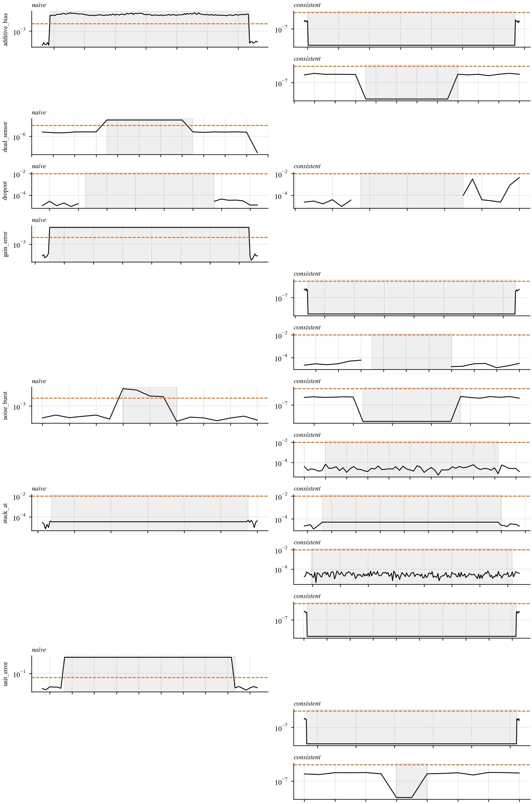
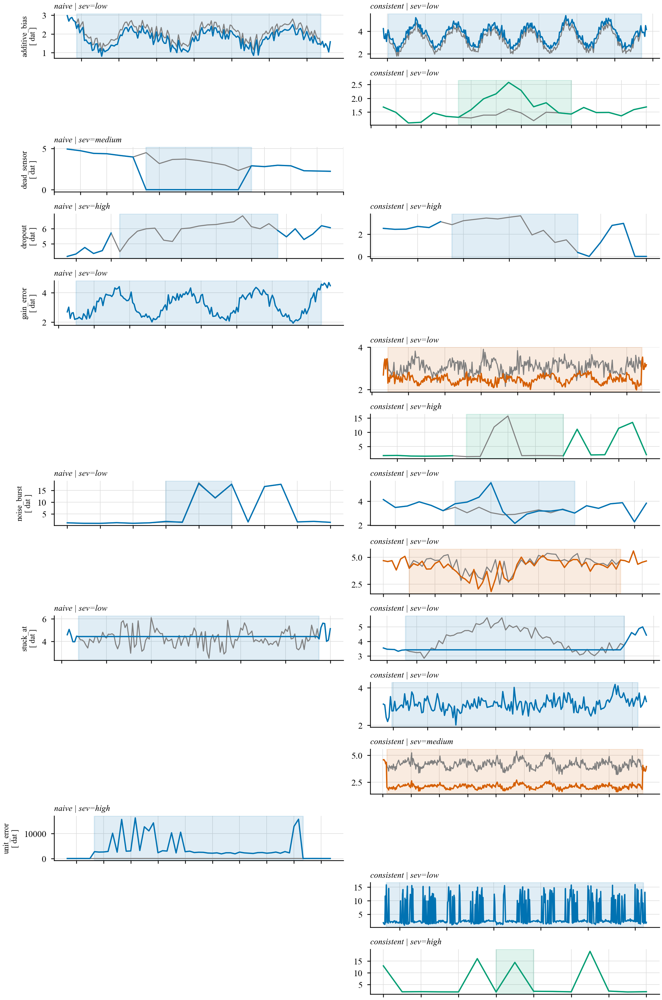

# Anomaly generation — mechanism and specification

> Phase 1 deliverable (challenge requirement: *document anomaly generation*).
> Implementation: `src/energymind/inject/` · Config: `configs/injection.yaml` ·
> Reproduce: `python -m energymind.inject --prevalence 0.05 --seed 1`.

This document explains **how anomalies are created**, **why they are created that
way**, and the **exact formulas, ranges and seeds** used. It is kept in sync with
`configs/injection.yaml` (which is the single source of truth for ranges) and the
code in `src/energymind/inject/`.

---

## 1. Why inject at all

The dataset ships with 698 provided `spike`/`dropout` labels, but the data audit
(`docs/data_report.md`, finding **F2**) showed they are trivial single-interval
events that break the electrical identities and are detected at ~100%. They are a
**sanity test set**, not a benchmark.

To evaluate detection *and* classification honestly we build the benchmark by
**injecting** anomalies we control: we know the exact window, the type, the
origin, the severity and the variant. The provided labels are masked out of the
clean baseline (`clean.py`) so they never mix into our ground truth.

---

## 2. The identity constraint (and the two variants)

The generator is formulaic (finding **F1**). On any clean row the following hold
almost exactly (median relative error ≈ 8e-6):

$$
S = \sqrt{P^2 + Q^2}, \qquad S = \frac{V \cdot I}{1000}, \qquad PF = \frac{P}{S}, \qquad E = 0.5\,P
$$

So editing **one channel** immediately breaks an identity and a physics check
catches it. That gives the two injection variants, which are the paper's
hypothesis **H1** (physics-consistent injection lowers every detector's F1 versus
naive injection):

| Variant | What it edits | Models | Identities |
| --- | --- | --- | --- |
| **naive** | one/few channels directly | corruption in transmission or storage | **break** |
| **consistent** | the *root* quantity, then all dependents are recomputed | an upstream sensor fault | **hold** |



*Maximum absolute identity residual per interval (log scale) with the `1e-2`
tolerance. Consistent edits (right column) stay below the tolerance; naive edits
(left column) shoot far above it.*

### 2.1 Propagators (how a "consistent" edit is applied)

Every consistent edit goes through one of the propagators below, so an identity
can never break by accident.

| Root edit | Recomputes | Example types |
| --- | --- | --- |
| `P`, `Q` | `S=√(P²+Q²)`, `I=S·1000/V`, `PF=P/S`, `E=0.5·P` | additive_bias, noise_burst, under_reporting, coherent_peak, mimicry |
| `I` | `S=V·I/1000`, `P=PF·S`, `Q=√(S²−P²)`, `E=0.5·P` | gain_error |
| `V` (power kept) | `S` unchanged, `I=S/V` | voltage_drift, voltage_sag |
| block copy | nothing (already consistent) | stuck_at, replay |
| blank | nothing | dropout |
| sub-meter only | nothing (breaks the *energy balance*, not the identities) | sub_meter_bias |

For the **naive** variant the root edit is applied **without** recomputation, so
the dependent channels keep their old values and the identity residual grows.

**Edge case — keeping `S > 0`.** When a consistent bias clips `P` to 0, scaling
`Q` with `P` would make `S = 0`, and the generator's `PF = 1` convention then
makes `r_PF` read 1.0 (a false identity break). The propagator therefore keeps
the original `Q` whenever `P` reaches 0, so `S = Q > 0` and the identity holds
(`inject/base.py::scaled_reactive`).

### 2.2 Robust scale and severity

For household `h` we compute the robust scale of the pre-edit level on
quality-masked rows:

$$
\sigma_h = 1.4826 \cdot \mathrm{MAD}\big(P - \text{hour-of-week median}\big)
$$

Severity is the **effect size in σ units**, measured separately for `P` and `V`
and combined as `max(effect_P, effect_V)` (NaNs count as 0, so an outage/dropout
shifts the level to zero):

| Severity | Effect size |
| --- | --- |
| `low` | `< 2 σ` |
| `medium` | `2 σ – 5 σ` |
| `high` | `> 5 σ` |

Each label stores the measured effects (`effect_p_sigma`, `effect_v_sigma`) in
`params`, so severity is always reproducible and comparable across types.

---

## 3. The 15 anomaly types

`dq` = `data_quality`, `adv` = `adversarial`, `phys` = `physical_event`.

| # | Type | Origin | Root edit (t ∈ window) | Consistent propagation | Variants | Parametric ranges |
| --- | --- | --- | --- | --- | --- | --- |
| 1 | `additive_bias` | dq | `P̃ = P + k·σ_h` | `Q̃ = Q·P̃/P`, then `S, I, PF, E` | both | `k ∈ ±{0.5, 1, 2}` |
| 2 | `gain_error` | dq | `Ĩ = (1+g)·I` | `S̃ = V·Ĩ`, `P̃ = PF·S̃`, `Q̃, Ẽ` | both | `g ∈ ±{0.05, 0.1, 0.25}` |
| 3 | `voltage_drift` | dq | `Ṽ = V + d·(t−t0)/L` | keep `S` → `Ĩ = S/Ṽ` | both | `d ∈ ±{2, 5, 10} V` |
| 4 | `stuck_at` | dq | hold all channels at `t0` | already consistent | both | — |
| 5 | `dropout` | dq | all channels → `NaN` | — | both | — |
| 6 | `dead_sensor` | dq | `P̃ = 0` only | — (that *is* the fault) | **naive only** | — |
| 7 | `noise_burst` | dq | `P̃ = P + ε`, `ε ~ N(0, (α·σ_h)²)` | scale `Q`, then dependents | both | `α ∈ {0.5, 1, 2}` |
| 8 | `unit_error` | dq | `P̃ = P · 1000` (W as kW) | — | **naive only** | factor `1000` |
| 9 | `sub_meter_bias` | dq | `sub2̃ = sub2 · (1+g)` | none (breaks `Σsub` vs `E` and the NILM residual) | **consistent only** | `g ∈ {0.3, 0.6}` |
| 10 | `under_reporting` | adv | `P̃ = r·P` (theft) | `Q̃ = r·Q`, then dependents | consistent | `r ∈ {0.3, 0.5, 0.8}` |
| 11 | `replay` | adv | copy the window from `t − 7d` | consistent by construction | consistent | `lag = 7d` |
| 12 | `mimicry` | adv | `P̃ = μ_h(how) + N(0, (0.1·σ_h)²)` | `Q̃` scaled, then dependents | consistent | `noise = 0.1` |
| 13 | `coherent_peak` | phys | `P̃ = P·(1 + p·sin(π·t/L))` on ≥ 40% of households | dependents | consistent | `p ∈ {0.3, 0.6, 1.0}` |
| 14 | `neighborhood_outage` | phys | all channels → 0, `V = 0`, **all** households | consistent | consistent | — |
| 15 | `voltage_sag` | phys | `Ṽ = 0.9·V`, power kept, **all** households | `I` rises | consistent | factor `0.9` |

Durations (`configs/injection.yaml` → `length.min` / `length.max`):

| Type | Length | Type | Length |
| --- | --- | --- | --- |
| additive_bias, gain_error | 12 h – 7 d | under_reporting | 3 d – 30 d |
| voltage_drift | 3 d – 30 d | replay | 1 d – 3 d |
| stuck_at | 12 h – 3 d | mimicry | 1 d – 7 d |
| dropout, dead_sensor | 30 min – 1 d / 1 h – 1 d | coherent_peak | 2 h – 6 h |
| noise_burst | 30 min – 6 h | neighborhood_outage | 30 min – 4 h |
| unit_error | 1 h – 1 d | voltage_sag | 1 h – 2 h |
| sub_meter_bias | 12 h – 7 d | | |

`stuck_at` durations deliberately exceed the natural flat runs of ~8 h (finding
**F9**) so flatness alone cannot separate them.



*One example per type × variant. Grey is the clean baseline, colour is the
injected series; the shaded band is the event window.*

---

## 4. Multi-household physical events

`coherent_peak`, `neighborhood_outage` and `voltage_sag` are applied to the
**same window across many households** (`scope = neighborhood`). `coherent_peak`
draws a random subset of at least 40% of households; the other two use all 13.

This is the key discriminative test: a genuine grid event and a single-meter
fault are **identical on one meter** and differ only in being *(a) simultaneous
across households* and *(b) physically consistent*. That is exactly the evidence
the Validator agent (Agent 2) uses to tell a `physical_event` from a
`data_quality`/`adversarial` fault.

---

## 5. Sampling protocol

Everything is driven by `configs/injection.yaml` and is fully seed-determined.

**Injection zones.** An edit is applied only where `quality_mask = 1` (Step 2):
no plausibility flag, internally consistent, not a provided anomaly, not imputed
and not a missing record. This guarantees injected labels never collide with the
provided ones or with data-quality artefacts.

**No overlap.** A per-household boolean occupancy bitmap (`Grid.occupied`) blocks
any new event from touching an existing one, so **one anomaly per (household,
interval)**. For `replay` the *source* window (`t − 7d`) must also be untouched
baseline, otherwise a previously injected anomaly would be copied.

**Prevalence.** `prevalence ∈ {0.01, 0.05, 0.10}` is the **target fraction of all
(household, interval) rows** that become anomalous:

$$
\text{target} = \text{prevalence} \times \#\text{rows}, \qquad
\text{per type} = \frac{\text{target}}{\#\text{types}}
$$

Events are drawn until each type's cumulative anomalous intervals reach its
share (or an attempt budget is hit). The realized prevalence is reported from the
labels, not assumed.

**Seeds.** `seed_base = 20261010`. Each `(prevalence, seed)` run is independent;
the evaluation uses `seeds = [1, 2, 3]` (`configs/models.yaml`). Identical
`(prevalence, seed)` reproduces byte-identical labels and series.

**Unseen-type test.** `replay` and `mimicry` are **withheld from train and
validation** (`withhold_from_train`) and injected into the **test split only**, so
the "unknown type → say unknown → escalate to a human" path can be evaluated.

**Multi-split.** Anomalies are placed in train, val and test, with separate seeds
per split, so detectors are fitted on train and judged on test.

---

## 6. Labels

Every event yields one row in `data/injected/labels.parquet` (committed):

| Column | Meaning |
| --- | --- |
| `anomaly_id` | deterministic UUID (from seed, prevalence, type, counter) |
| `household_id` | one household, or a comma-joined list for neighbourhood events |
| `t_start`, `t_end` | half-open UTC window `[t_start, t_end)` |
| `type` | one of the 15 types |
| `origin` | `data_quality` \| `adversarial` \| `physical_event` |
| `severity` | `low` \| `medium` \| `high` (effect size in σ) |
| `variant` | `naive` \| `consistent` |
| `scope` | `single` \| `neighborhood` |
| `params` | JSON string: the sampled parameters plus `effect_p_sigma`, `effect_v_sigma` |
| `seed` | the run seed |
| `injector_version` | `0.1.0` |
| `provenance` | `simulated` |

Example run (`prevalence = 5%`, `seed = 1`): **290 events** —
`data_quality` 221, `physical_event` 53, `adversarial` 16; `consistent` 149 /
`naive` 141; `neighborhood` 53; severity low 157 / medium 35 / high 98.

---

## 7. Verification (what the tests assert)

`tests/test_injection.py`:

1. **Consistency** — every consistent event keeps `|r_S|, |r_VI|, |r_E|, |r_PF| <
   1e-2` over its whole window.
2. **Detectability** — naive single-channel edits (bias, gain, drift, noise,
   dead, unit) break at least one identity.
3. **Determinism** — same `(prevalence, seed)` → identical labels and series.
4. **Zone** — every event row has `quality_mask = 1`.
5. **Non-overlap** — no two windows in a household intersect.
6. **Scope** — physical events span multiple households (`scope = neighborhood`).
7. **Withholding** — `replay`/`mimicry` appear only in the test split.

On the real 5%/seed-1 run: 0 of 149 consistent events break an identity; no
overlaps; no event outside the quality mask.

---

## 8. Outputs

| Path | Committed? | Rebuilt from seed? |
| --- | --- | --- |
| `data/injected/labels.parquet`, `labels_p{p}_s{seed}.parquet` | yes (small) | deterministic, but kept for the report |
| `data/injected/injected_p{p}_s{seed}.parquet` | no (gitignored, ~21 MB) | yes — regenerate with the seed |

The injected series are large, so they are **not committed**: they are rebuilt
from `(prevalence, seed)` by `inject_all`. After injection, **all features are
recomputed from the injected channels** (Step 6); baseline features are never
reused.

---

## 9. Reproducing

```bash
# labels + one injected series for prevalence=5%, seed=1
python -m energymind.inject --prevalence 0.05 --seed 1

# the full grid (prevalence 1/5/10% × seeds 1/2/3), labels + series
python -m energymind.inject

# gallery figures (one example per type × variant + residual view)
python -m energymind.inject_plots --prevalence 0.05 --seed 1

# notebook: notebooks/03_injection_gallery.ipynb
```

Module map: `inject/base.py` (dataclasses, propagators, severity, sampling),
`inject/data_quality.py` (9 types), `inject/adversarial.py` (3),
`inject/physical.py` (3), `inject/__init__.py` (`REGISTRY`, `inject_all`,
prevalence loop, withholding).

---

## 10. Scope and limitations

- **Phase 1 types only.** 15 single or neighbourhood patterns; no compound or
  overlapping faults.
- **Synthetic.** The anomalies are injected into a synthetic dataset with weak
  weather–load coupling (findings F5–F6); no claim is made about real fault
  rates.
- **Severity is a proxy.** Effect size in σ is comparable across types but is not
  a physical damage estimate.

**Phase 2 extensions:** compound and overlapping faults; drift that follows
temperature; coordinated multi-meter falsification that preserves neighbourhood
totals; per-month injection streams for federated continual learning
(`experience_id = month`).
