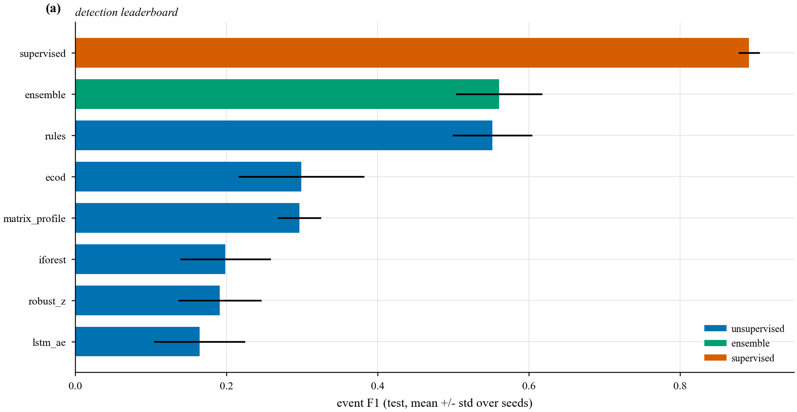
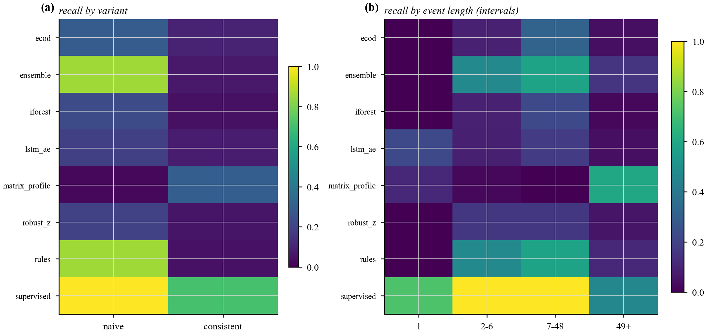
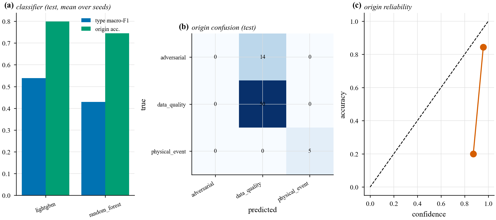
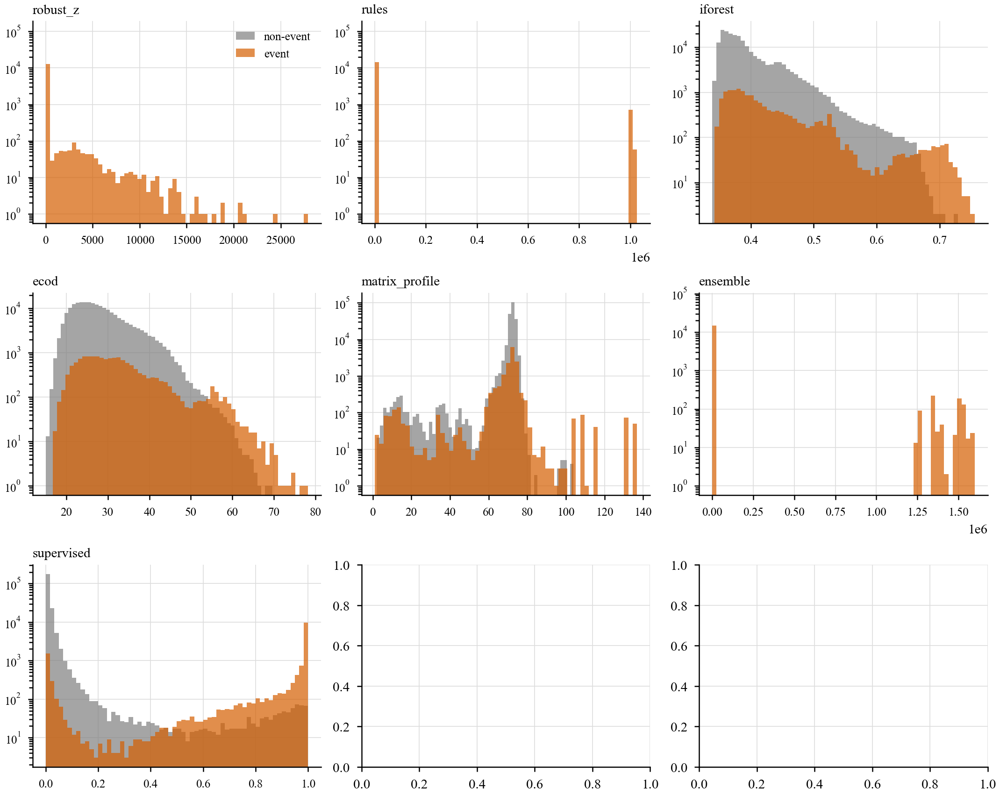
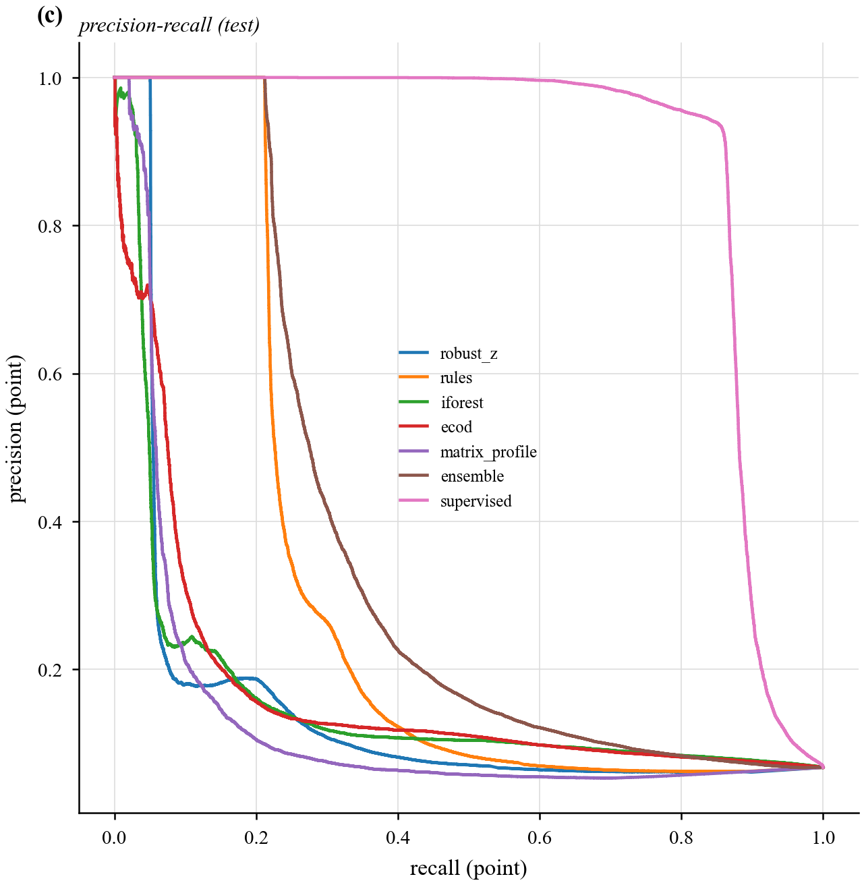

# Benchmark: detection and classification (Step 8)

> Implementation: `src/energymind/benchmark.py`, `detect/`, `classify.py`, `evaluate.py`,
> `benchmark_plots.py`. Results: `results/runs.jsonl`. Figures: `results/figures/bench_*.png`.
> Reproduce: `python -m energymind.benchmark --prevalence 0.05 --seeds 1 2 3`.

This document specifies how the anomaly detectors and the type/origin classifier
are evaluated, and reports the Phase 1 results.

---

## 1. Scope

Two tasks are scored **separately**:

* **Detection** — is this window anomalous? Scored at **event level** against the
  injected labels.
* **Classification** — which `type` and `origin`? Scored per event.

Detection and classification are deliberately decoupled: unsupervised detectors
cannot emit a *type*, so classification is a separate supervised model.

## 2. What the models consume

| Artifact | Shape | Role |
| --- | --- | --- |
| `data/injected/injected_p{p}_s{seed}.parquet` | 227,760 × 54 | injected multi-channel series (time-series detectors) |
| `data/features/features.parquet` | 227,760 × 99 | past-only feature table (tabular detectors, classifier) |
| `data/injected/labels.parquet` | events × 13 | ground truth: `type`, `origin`, `severity`, `variant`, `scope` |
| `data/splits.json` | — | temporal windows + 3 hold-out households |

The detectors never see the raw CSV or the clean baseline; features are
recomputed on the injected series (`features.build_features`). One dataset is
produced **per `(prevalence, seed)`**; the reported grid uses prevalence 5% and
seeds 1–3.

## 3. Detectors

| Detector | Family | Input | What it targets |
| --- | --- | --- | --- |
| `robust_z` | baseline | `|P - median(how)| / (1.4826 MAD)` | the bar to beat |
| `rules` | rules | physics residuals + baseline z + coherence | naive injections (broken identities) |
| `iforest` | classical ML | window features | tabular outliers |
| `ecod` | statistical (PyOD) | window features | parameter-free tail anomalies |
| `matrix_profile` | distance | univariate P (STUMPY) | discords **+ 7-day replay check** |
| `ensemble` | ensemble | soft vote of rules + ecod + matrix_profile + iforest | combined unsupervised |
| `lstm_ae` | deep | 48-step multichannel windows (PyTorch) | multivariate reconstruction |
| `supervised` | supervised | interval features + physics + NILM residual | **labelled upper bound** |

All detectors implement the same interface (`fit` on train, `score` → higher =
more anomalous) and consume the Step 6 feature table.

## 4. Evaluation protocol

* **Unit = the injected event.** An event counts as detected if **any alert** falls
  inside `[t_start − 1, t_end + 1]`. Neighbourhood events count once, even though
  they touch many households. Events are restricted to those overlapping the
  evaluated split (`evaluate.relevant_events`), so a test score is not diluted by
  train/val events.
* **No point-adjusted F1.** Precision is measured over the alerts themselves.
* **Thresholds** are chosen on **validation** at a fixed false-alarm budget of
  **1 per household-week** (`configs/models.yaml`), but **at event level**: among
  thresholds satisfying the budget we pick the one maximising event-F1.
  * `global` — one threshold for all households;
  * `+ph` — one threshold **per household** (each within its share of the budget);
  * `.oracle` — the best threshold on the **test** split with **no** budget
    constraint (an upper bound for that score, not a usable operating point).
* **Splits.** Temporal train (Jan–Aug) / val (Sep–Oct) / test (Nov–Dec) **and** a
  3-household hold-out (`HH_00053`, `HH_00072`, `HH_00089`). Detectors are fit on
  train, thresholded on val, reported on test (and the hold-out).
* **Seeds.** 3 injection seeds, mean ± std.

## 5. Metrics (`evaluate.evaluate`)

| Metric | Definition |
| --- | --- |
| `event_recall` | detected events / events |
| `alert_precision` | alerts inside an event / all alerts |
| `event_f1` | harmonic mean of the two |
| `pr_auc` | point-level average precision |
| `fa_per_household_week` | false alarms / (households × weeks) |
| `latency_median` | intervals from `t_start` to the first alert |
| `recall_by_type/severity/variant/scope` | event recall per group |
| `recall_by_length` | event recall by length bucket (1, 2–6, 7–48, 49+ intervals) |

Classification reports `type_macro_f1`, `origin_accuracy` and `origin_ece`
(expected calibration error).

## 6. Results — 3 seeds, prevalence 5%, temporal test split

**Detection** (mean ± std of event-F1; precision/recall and FA at the global
operating point):

| Detector | event F1 | recall | precision | PR-AUC | FA / hh-week |
| --- | --- | --- | --- | --- | --- |
| **supervised** | **0.891 ± 0.014** | 0.84 | 0.95 | 0.72 | 0.77 |
| ensemble (`+ph`) | 0.683 ± 0.027 | — | — | — | — |
| ensemble | 0.561 ± 0.057 | 0.41 | 0.94 | 0.43 | 0.52 |
| rules (`+ph`) | 0.577 ± 0.034 | — | — | — | — |
| **rules** | **0.552 ± 0.053** | 0.40 | 0.95 | 0.27 | 0.44 |
| ecod (`+ph`) | 0.403 ± 0.080 | — | — | — | — |
| robust_z (`+ph`) | 0.374 ± 0.068 | — | — | — | — |
| iforest (`+ph`) | 0.360 ± 0.152 | — | — | — | — |
| ecod | 0.299 ± 0.083 | 0.18 | 0.85 | 0.31 | 0.37 |
| matrix_profile | 0.296 ± 0.029 | 0.18 | 0.87 | 0.28 | 0.84 |
| iforest | 0.199 ± 0.060 | 0.13 | 0.50 | 0.25 | 1.26 |
| robust_z | 0.191 ± 0.055 | 0.12 | 0.69 | 0.15 | 0.83 |
| lstm_ae | 0.164 ± 0.060 | 0.13 | 0.32 | 0.12 | 1.73 |

**Oracle ceilings** (best achievable event-F1 for each score, mean over seeds):
`supervised 0.896`, `ensemble 0.656`, `rules 0.561`, `ecod 0.453`, `iforest 0.414`,
`matrix_profile 0.339`, `robust_z 0.320`, `lstm_ae 0.241`. The supervised score
sits essentially at its ceiling; the unsupervised scores have headroom only via
better models, not better thresholds.

**Where the misses are (seed 1).** For the strongest unsupervised detector
(`rules`):

| | naive | consistent |
| --- | --- | --- |
| recall | **0.80** | **0.15** |

| length (intervals) | 1 | 2–6 | 7–48 | 49+ |
| --- | --- | --- | --- | --- |
| `rules` recall | 0.00 | 0.57 | 0.60 | 0.22 |

So the unsupervised detectors find the **naive** (identity-breaking) faults and
mostly miss the **consistent** ones — hypothesis **H1** confirmed. The
**supervised** detector, trained on the labels, recovers `consistent` recall to
**0.68** (naive 1.0).





## 7. Classification

Each **event** becomes one case: detector-relevant features are aggregated
(mean and max) over the event window, plus the four detector scores, duration and
scope. LightGBM (primary) and Random Forest (TreeSHAP-friendly comparison) are
isotonic-calibrated and chosen by validation macro-F1.

| Model | type macro-F1 | origin accuracy | origin ECE |
| --- | --- | --- | --- |
| LightGBM (selected) | 0.51 – 0.57 | 0.80 | 0.15 – 0.20 |
| Random Forest | 0.43 | 0.75 | 0.22 |

Type macro-F1 is noisy because there are only ~200 train / ~69 test events and
some types have 1–4 examples; per-seed values are in `runs.jsonl`.



Score separability and the precision-recall curves behind the leaderboard:





## 8. Selection rule

> Pick the detector with the best **event-F1 at the fixed false-alarm budget**,
> among those meeting a recall floor on high-severity anomalies; report 3 seeds
> mean ± std, no point-adjusted F1.

## 9. Reproduce

```bash
python -m energymind.inject --prevalence 0.05 --seed 1   # labels + series
python -m energymind.features                            # features + NILM
python -m energymind.benchmark --prevalence 0.05 --seeds 1 2 3
python -m energymind.benchmark_plots --prevalence 0.05 --seed 1
```

`results/runs.jsonl` — one record per `(task, model, thresholding, prevalence,
seed, split)` with metrics, `git_commit`, `config_hash`, timestamp. Figures:
`bench_detection_leaderboard`, `bench_detector_tradeoff`, `bench_recall_breakdown`,
`bench_score_distributions`, `bench_pr_curves`, `bench_classifier`.

## 10. Limitations

* Synthetic data with weak weather–load coupling; **no claim about real fault
  rates**.
* The supervised detector uses the injected labels and is an **upper bound**, not
  a deployable unsupervised method.
* `lstm_ae` is trained briefly (CPU); USAD/TranAD would be the upgrade.
* Only prevalence 5% × seeds 1–3 is reported here; the grid is configurable.
* Classification is limited by the small number of events per type.
