# Data report - Austin_TX_US_2020.csv

> Generated by `python -m energymind.eda`. All numbers below are computed from the data.

The input is a synthetic single-city panel: **13 smart-metered households, 30-minute interval, 1 Jan - 30 Dec 2020, 104 columns**. It carries Tunisian-grid-compatible electrical parameters (230 V, 50 Hz) on an Austin calendar and climate; we state this explicitly in the paper.

The findings shape the whole pipeline (drop derived columns, mask the provided labels, inject consistently, use cross-household coherence).

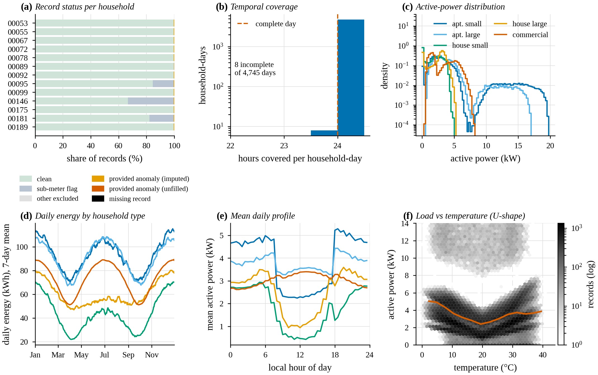

| # | Finding | Consequence |
| --- | --- | --- |
| F1 | Electrical identities hold almost exactly | The data is generated by formula, so a physics check is an exact detector; injection and imputation must propagate consistently across channels. |
| F2 | Provided labels are trivial single-interval events | They are trivially detectable and unrealistic; use them as a sanity test set and build the real benchmark by injection. |
| F3 | Rolling features include the current value (leakage) | Using them is label leakage and they would not move on injection; drop all 64 and recompute past-only features after injection. |
| F4 | Electrical parameters are 230 V / 50 Hz, cost in EUR | Not US parameters (Austin is 120/240 V, 60 Hz); frame honestly as Tunisian-grid-compatible parameters on an Austin calendar and climate. |
| F5 | Weather is generated per row, not shared | Weather features are weak evidence; do not build 'genuine heat-wave' logic on them without injecting coherent events. |
| F6 | Thermal load is V-shaped in temperature (linear correlation is blind to it) | Heating and cooling sub-meters both rise with the distance from ~20 C (so both are high in winter and summer and their labels are not physical); the zero linear correlation hides a strong non-monotonic dependence. Load is higher at night because the occupancy schedule, not temperature, sets the daily profile. Temperature is a valid explanatory feature through |T - 20 C|, but it is generated per household (F5), so coherent heat-wave events must still be injected. |
| F7 | Sub-meters are not a closed energy balance | There is an unmetered remainder; a 'sub-meters > total' check is useful but noisy, and it fires only where PV makes the net total smaller than the gross sub-meters. |
| F8 | Metadata contradicts itself | Do not use size or type as features or as explanations. |
| F9 | Natural flat runs reach ~16 intervals | Stuck-at injections shorter than ~8 h are indistinguishable by flatness alone; use multi-channel evidence. The natural runs sit at near-zero load, which the sub-meter flag already excludes from the quality mask. |
| F10 | Households correlate daily but weakly at 30 min | Cross-household coherence is usable to separate genuine events from faults at hourly/daily scale. |
| O1 | The daily profile is a two-level occupancy schedule | Load steps down at 09:00 and up at 18:00 for residential types; the hour-of-week baseline therefore reduces to a two-level schedule plus a small weekend uplift. |
| O2 | DER channels have clean, learnable signatures | PV is zero at night and tied to cloud cover; EV charging is confined to 18-08 h and dominates the household's power (bimodal load). Detectors need household-specific or DER-aware baselines, and PV can legitimately push net load far below the household's peers at midday. |
| O3 | A baseline fitted on the training months drifts in validation and test | Seasonality (F6) shifts the level between splits, so a fixed hour-of-week baseline produces biased residuals out of sample. Step 6 should add |T - 20 C| or a trailing seasonal level, and thresholds must be fixed on validation only. |

## F1 - Electrical identities hold almost exactly

| Metric | Value |
| --- | --- |
| max |r_S|, |r_VI|, |r_E|, |r_PF| | 2.48e-04 |
| median |r_S| | 8.29e-06 |
| median rel. cost = E*tariff error | 5.54e-06 |

**Consequence.** The data is generated by formula, so a physics check is an exact detector; injection and imputation must propagate consistently across channels.

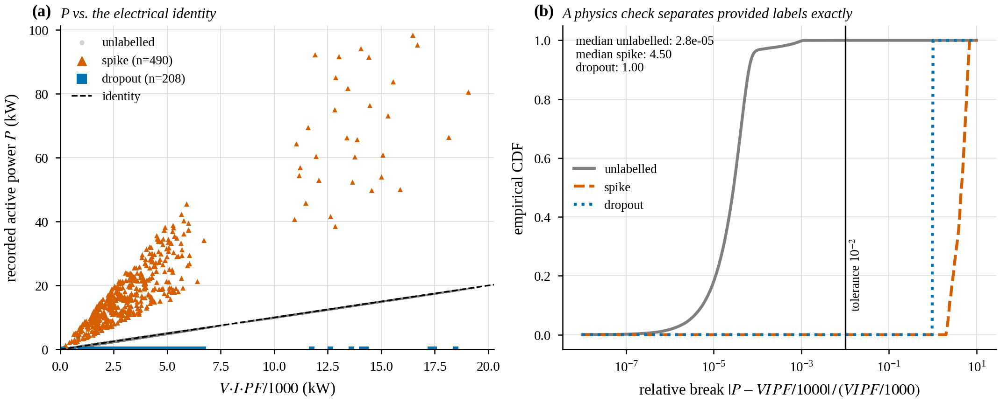

*(a) Recorded active power against V·I·PF/1000; provided spikes and dropouts leave the identity. (b) Empirical CDF of the relative break: a 10^-2 tolerance separates the provided labels from all other records.*

## F2 - Provided labels are trivial single-interval events

| Metric | Value |
| --- | --- |
| runs | 697 |
| runs of length 1 | 696 |
| max run length | 2 |
| dropout rows with P = 0 | 1.000 |
| spike median |P - V*I*PF/1000| / P | 0.818 |

**Consequence.** They are trivially detectable and unrealistic; use them as a sanity test set and build the real benchmark by injection.

## F3 - Rolling features include the current value (leakage)

| Metric | Value |
| --- | --- |
| median |power_2h_mean - rolling incl. t| | 0.00e+00 |
| median |power_2h_mean - rolling excl. t| | 0.088 |
| pre-computed derived columns | 64 |

**Consequence.** Using them is label leakage and they would not move on injection; drop all 64 and recompute past-only features after injection.

## F4 - Electrical parameters are 230 V / 50 Hz, cost in EUR

| Metric | Value |
| --- | --- |
| voltage min / median / max | 217 / 230 / 241 V |
| frequency mean +/- std | 50.00 +/- 0.05 Hz |
| tariff_rate median | 0.250 |

**Consequence.** Not US parameters (Austin is 120/240 V, 60 Hz); frame honestly as Tunisian-grid-compatible parameters on an Austin calendar and climate.

## F5 - Weather is generated per row, not shared

| Metric | Value |
| --- | --- |
| median between-household temp std | 1.46 C |
| 'snow' rows with temp > 10 C | 7201 |

**Consequence.** Weather features are weak evidence; do not build 'genuine heat-wave' logic on them without injecting coherent events.

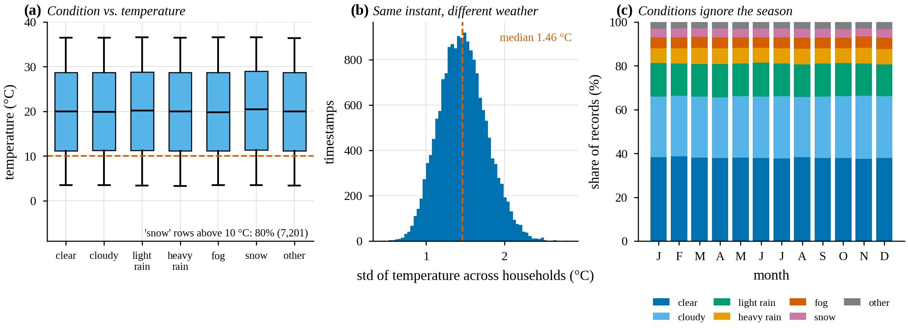

*(a) Temperature by weather condition is identical across conditions. (b) Temperature varies across households at the same instant. (c) Condition shares are constant over the year.*

## F6 - Thermal load is V-shaped in temperature (linear correlation is blind to it)

| Metric | Value |
| --- | --- |
| corr(sub2_cooling, temperature) | -0.000 |
| corr(sub2_cooling, |T - 20 C|) | 0.549 |
| corr(sub1_heating, |T - 20 C|) | 0.642 |
| monthly load: peak / trough | 4.16 kW / 2.77 kW |
| mean load 00-07 h | 3.90 kW |
| mean load 07-19 h | 2.93 kW |

**Consequence.** Heating and cooling sub-meters both rise with the distance from ~20 C (so both are high in winter and summer and their labels are not physical); the zero linear correlation hides a strong non-monotonic dependence. Load is higher at night because the occupancy schedule, not temperature, sets the daily profile. Temperature is a valid explanatory feature through |T - 20 C|, but it is generated per household (F5), so coherent heat-wave events must still be injected.

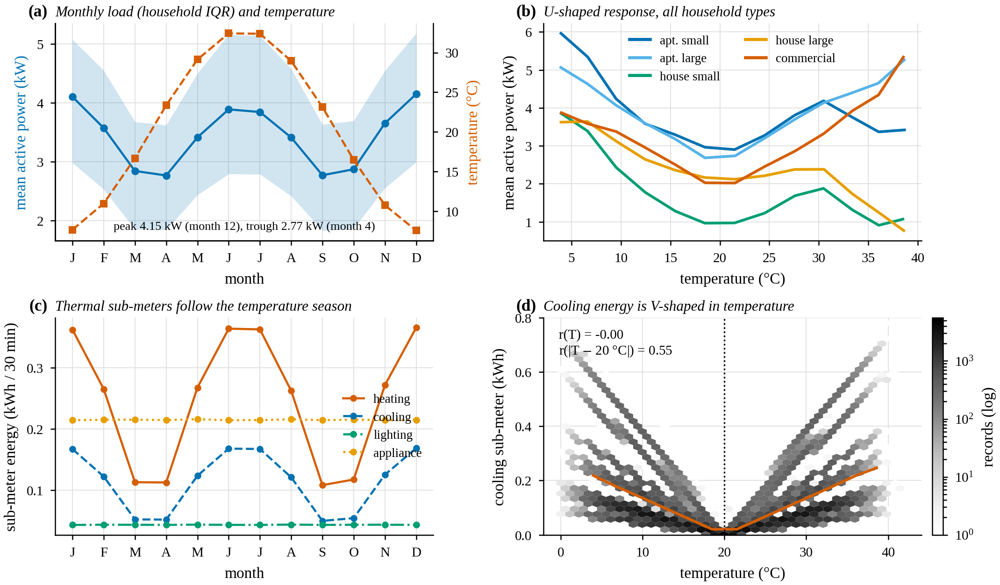

*(a) Monthly load and temperature, (b) load versus temperature by household type, (c) monthly sub-meter energy, (d) cooling sub-meter versus temperature: V-shaped around 20 °C, hence zero linear correlation.*

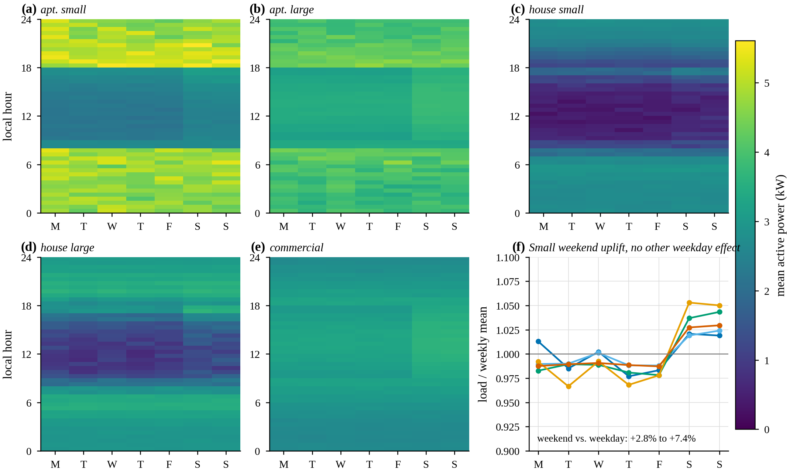

*Mean active power by local half-hour and weekday for each household type (a-e) and weekday load relative to the weekly mean (f).*

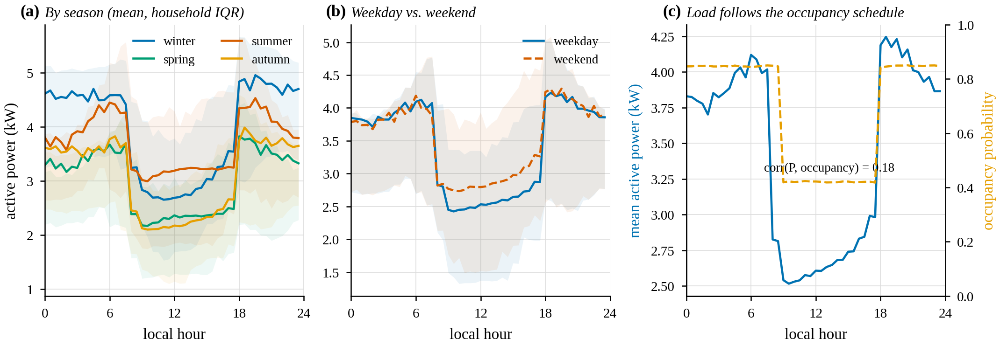

*Mean daily profile by season (a), weekday versus weekend (b) and load versus occupancy probability (c); bands are household inter-quartile ranges.*

## F7 - Sub-meters are not a closed energy balance

| Metric | Value |
| --- | --- |
| median sub-meter share | 0.428 |
| 5th percentile | 0.141 |
| 95th percentile | 1.077 |
| sub-meter > total rows in PV households | 100.0% |

**Consequence.** There is an unmetered remainder; a 'sub-meters > total' check is useful but noisy, and it fires only where PV makes the net total smaller than the gross sub-meters.

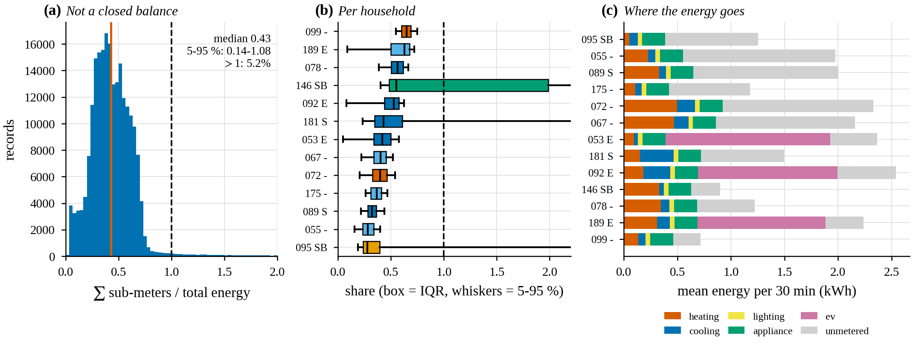

*(a) Sub-meter sum over total energy, (b) per household (tags: S PV, B battery, E EV), (c) mean energy decomposition including the unmetered remainder.*

## F8 - Metadata contradicts itself

| Metric | Value |
| --- | --- |
| min size of house_large | 73 m2 |
| max size of apartment_small | 246 m2 |
| distinct household types | 5 |

**Consequence.** Do not use size or type as features or as explanations.

## F9 - Natural flat runs reach ~16 intervals

| Metric | Value |
| --- | --- |
| max flat run (baseline) | 16 |
| rows in runs >= 8 | 103 (0.0452%) |
| load level of the long runs | ~0.01 kW |

**Consequence.** Stuck-at injections shorter than ~8 h are indistinguishable by flatness alone; use multi-channel evidence. The natural runs sit at near-zero load, which the sub-meter flag already excludes from the quality mask.

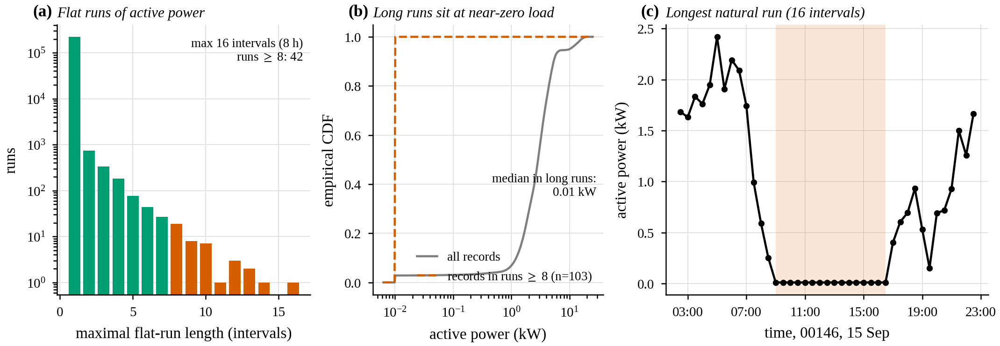

*(a) Maximal flat-run lengths of active power, (b) power level of records inside runs of at least 8 intervals, (c) the longest natural run.*

## F10 - Households correlate daily but weakly at 30 min

| Metric | Value |
| --- | --- |
| mean pairwise corr (30 min) | 0.306 |
| mean pairwise corr (daily) | 0.730 |

**Consequence.** Cross-household coherence is usable to separate genuine events from faults at hourly/daily scale.

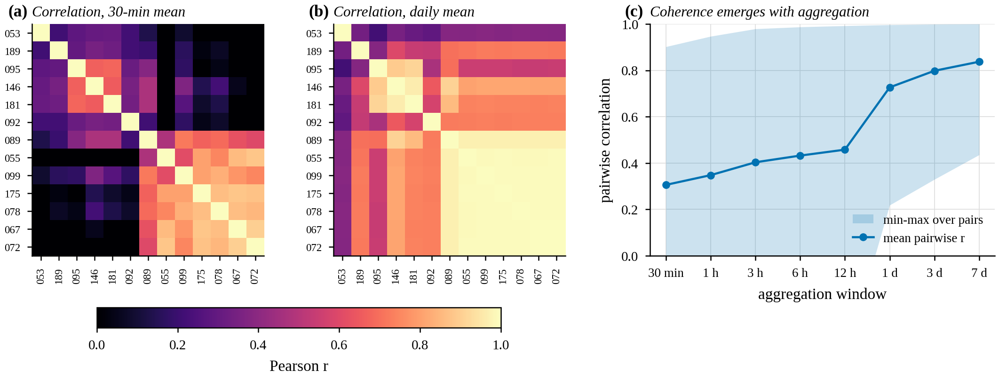

*Pairwise household correlation at 30 minutes (a) and one day (b), clustered; (c) mean and range of pairwise correlation versus aggregation window.*

## O1 - The daily profile is a two-level occupancy schedule

| Metric | Value |
| --- | --- |
| occupancy probability, 18-09 h / 09-18 h | 0.85 / 0.42 |
| corr(P, occupancy_probability) | 0.18 |
| weekend vs weekday load | +2.8% to +7.4% |
| commercial_small day/night ratio | 1.13 |

**Consequence.** Load steps down at 09:00 and up at 18:00 for residential types; the hour-of-week baseline therefore reduces to a two-level schedule plus a small weekend uplift.

*Mean daily profile by season (a), weekday versus weekend (b) and load versus occupancy probability (c); bands are household inter-quartile ranges.*

*Mean active power by local half-hour and weekday for each household type (a-e) and weekday load relative to the weekly mean (f).*

## O2 - DER channels have clean, learnable signatures

| Metric | Value |
| --- | --- |
| corr(PV / capacity, cloud cover), 10-14 h | -0.88 |
| PV output at night | 0.0 kW (max) |
| EV charging probability, 18-08 h / 08-18 h | 0.40 / 0.0001 |
| EV on-power median (range) | 11.3 kW (3.6-17.5) |

**Consequence.** PV is zero at night and tied to cloud cover; EV charging is confined to 18-08 h and dominates the household's power (bimodal load). Detectors need household-specific or DER-aware baselines, and PV can legitimately push net load far below the household's peers at midday.

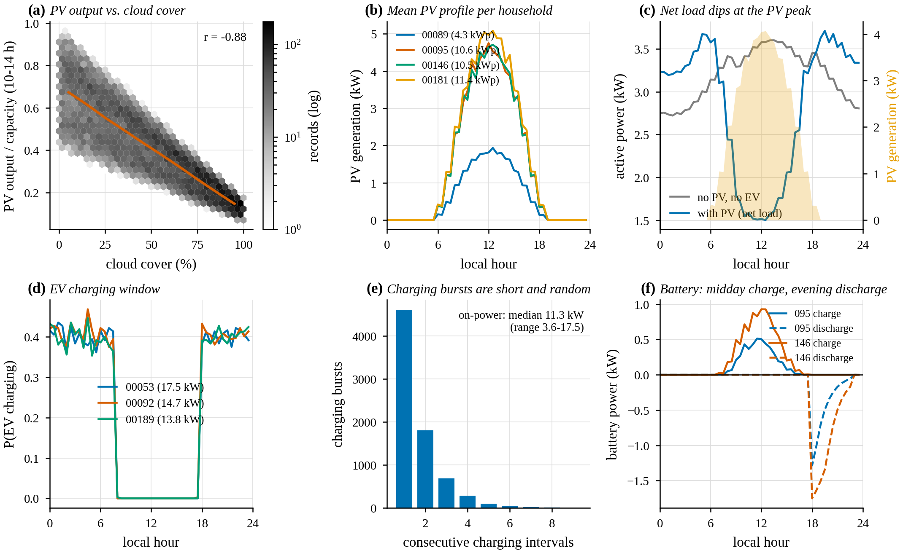

*Distributed resources: PV against cloud cover (a), mean PV profile (b), net load with and without PV (c), EV charging probability (d) and burst length (e), battery profile (f).*

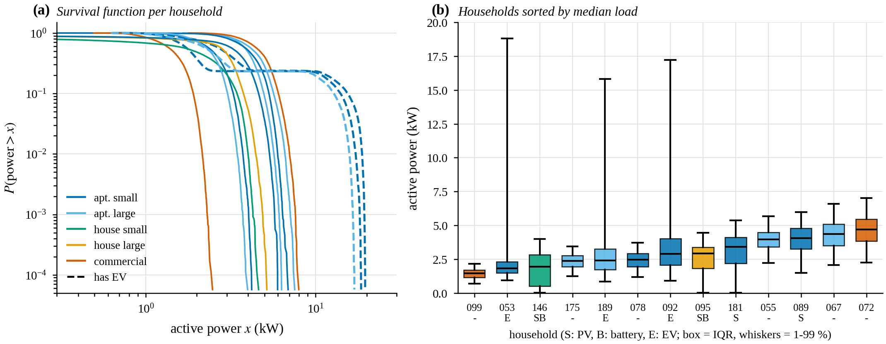

*(a) Survival function of active power per household (dashed: has EV), (b) load per household sorted by median.*

## O3 - A baseline fitted on the training months drifts in validation and test

| Metric | Value |
| --- | --- |
| median daily energy, train / val / test | 82 kWh / 71 kWh / 97 kWh |
| median residual z, train / val / test | +0.00 / -0.99 / +0.45 |

**Consequence.** Seasonality (F6) shifts the level between splits, so a fixed hour-of-week baseline produces biased residuals out of sample. Step 6 should add |T - 20 C| or a trailing seasonal level, and thresholds must be fixed on validation only.

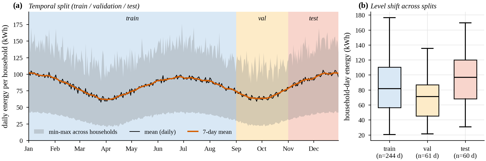

*(a) Network daily energy with the train/validation/test windows, (b) household-day energy per split.*

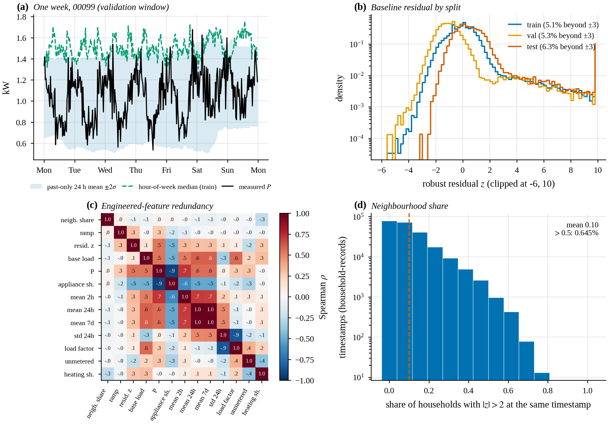

*Past-only EDA features: (a) one week with rolling band and hour-of-week baseline, (b) baseline residual by split, (c) feature redundancy, (d) neighbourhood share.*
